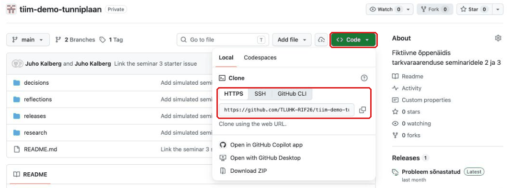

# Git ja GitHub

**Märge:** Seminaris

## Versioonihaldus

Kui mitu inimest muudab samu faile, tekivad küsimused: kes mida muutis, milline versioon on õige ja kuidas vana seisu tagasi saada? Failinimed nagu `aruanne-uus-LOPLIK-2.docx` neile ei vasta.

**Versioonihaldus** (*version control*) salvestab iga muudatuse koos autori, aja ja selgitusega. Nii saab vaadata ajalugu, võrrelda versioone ja töötada mitmekesi samas projektis.

## Git ja GitHub ei ole sama asi

**Git** on versioonihaldustarkvara. See töötab sinu arvutis ja aitab:

- näha, milliseid faile muudeti;
- salvestada seotud muudatused üheks versiooniks ehk **commit'iks**;
- vaadata muudatuste ajalugu;
- töötada eraldi harudes ja ühendada mitme inimese töö.

**GitHub** on veebiplatvorm, kus hoitakse Giti repositooriume. Lisaks failide hoidmisele pakub GitHub:

- kasutajakontosid, organisatsioone ja ligipääsuõigusi;
- Issue'sid ülesannete kirjeldamiseks;
- pull request'e ja ülevaatusi;
- Projects'i töö planeerimiseks.

Git töötab ka ilma GitHubita. GitHub ilma Gitita aga ei tööta. Sarnaseid platvorme on teisigi, näiteks GitLab ja Bitbucket.

## Kohalik ja kaugrepositoorium

**Repositoorium** (*repository*, lühidalt *repo*) on projekti failid koos kogu muudatuste ajalooga.

- **Kohalik repositoorium** asub sinu arvutis. Seal sa töötad.
- **Kaugrepositoorium** (*remote repository*) asub näiteks GitHubis. Selle kaudu jagab meeskond tööd.

```text
Sinu arvuti                              GitHub
┌──────────────────┐    push          ┌──────────────────┐
│ kohalik repo     │ ───────────────► │ kaugrepo         │
│ muuda ja commit'i│ ◄─────────────── │ teiste muudatused│
└──────────────────┘    pull          └──────────────────┘
```

| Mõiste | Tähendus |
|---|---|
| **clone** | kaugrepo koopia loomine oma arvutisse |
| **commit** | salvestatud ja selgitusega muudatuste komplekt |
| **push** | kohalike commit'ide saatmine kaugrepo'sse |
| **pull** | kaugrepo muudatuste toomine oma arvutisse |



Repo kloonimiseks kopeeri GitHubis rohelise **Code** nupu alt HTTPS-aadress ja käivita terminalis:

```bash
git clone https://github.com/omanik/repo.git
cd repo
```

Asenda `omanik/repo` tegeliku repo aadressiga.

## HTTPS ja SSH

GitHubiga saab ühenduda kahel viisil:

```text
HTTPS  https://github.com/omanik/repo.git
SSH    git@github.com:omanik/repo.git
```

- **HTTPS** kasutab sisselogimist brauseri kaudu. Seda on algajal lihtsam seadistada.
- **SSH** kasutab võtmepaari: privaatne võti jääb sinu arvutisse, avalik võti lisatakse GitHubi. See on mugav, kuid vajab mitut lisasammu.

Kursusel kasutame HTTPS-i. SSH-st loe vajaduse korral [GitHubi juhendist](https://docs.github.com/en/authentication/connecting-to-github-with-ssh/about-ssh).

## Giti paigaldamine

Kontrolli kõigepealt, kas Git on juba olemas:

```bash
git --version
```

Kui vastuses on versiooninumber, on Git paigaldatud. Kui näed teadet `command not found` või `not recognized`, paigalda Git.

- **Windows:** laadi alla [Git for Windows](https://git-scm.com/install/windows) ja jäta paigaldamisel vaikevalikud. Koos Gitiga paigaldatakse Git Bash.
- **macOS:** paigalda [Homebrew](https://brew.sh/) ja seejärel käsk `brew install git`. Teine võimalus on `xcode-select --install`.
- **Linux:** kasuta oma distributsiooni paketihaldurit, näiteks `sudo apt install git`.

Pärast paigaldamist sulge terminal ja VS Code ning ava need uuesti.

Seejärel ütle Gitile oma nimi ja e-post. Git lisab need igale commit'ile.

```bash
git config --global user.name "Sinu Nimi"
git config --global user.email "sinu@naide.ee"
```

> [!TIP]
> Avalikus repos on commit'i e-post kõigile nähtav. Kasuta GitHubi privaatset `noreply` aadressi: GitHubi seadetes **Settings → Emails**.

### Levinud probleemid

| Probleem | Lahendus |
|---|---|
| Terminal või VS Code ei leia Giti | Sulge kõik terminalid ja VS Code ning ava uuesti. |
| GitHub küsib korduvalt sisselogimist | Windowsis on Git Credential Manager Gitiga kaasas. Logi sisse brauseris avanevas aknas. |
| Paigaldamiseks puuduvad õigused | Ära proovi piiranguid mööda minna. Küsi abi õppejõult või IT-toelt. |

## GitHub CLI

**GitHub CLI** on GitHubi ametlik käsureatööriist. Selle käsk on `gh`. Erinevus Gitist:

- `git` haldab versiooniajalugu ning saadab ja toob commit'e;
- `gh` suhtleb GitHubi teenusega, näiteks näitab Issue'sid.

`gh` on valikuline lisatööriist. Paigaldusjuhise leiad aadressilt [cli.github.com](https://cli.github.com/). Pärast paigaldamist logi sisse:

```bash
gh auth login
```

Need käsud ainult näitavad infot ega muuda midagi:

```bash
gh repo view          # repo kirjeldus
gh issue list         # avatud Issue'd
gh issue view 2       # Issue nr 2 sisu
gh issue view 2 --web # Issue nr 2 brauseris
```

Käivita need kloonitud repo kaustas.

## Kontrolli ennast

1. Mis vahe on Gitil ja GitHubil?
2. Mis vahe on kohalikul ja kaugrepositooriumil?
3. Mida teevad `clone`, `push` ja `pull`?
4. Kontrolli terminalis, et Git on paigaldatud ning nimi ja e-post on seadistatud: `git config --global --list`.

*Kuvatõmmised seisuga: november 2026.*

---

[← IDE ja terminal](03-ide-and-terminal.md) | [Sisukord](../README.md) | [Järgmine: Markdown →](05-markdown.md)
