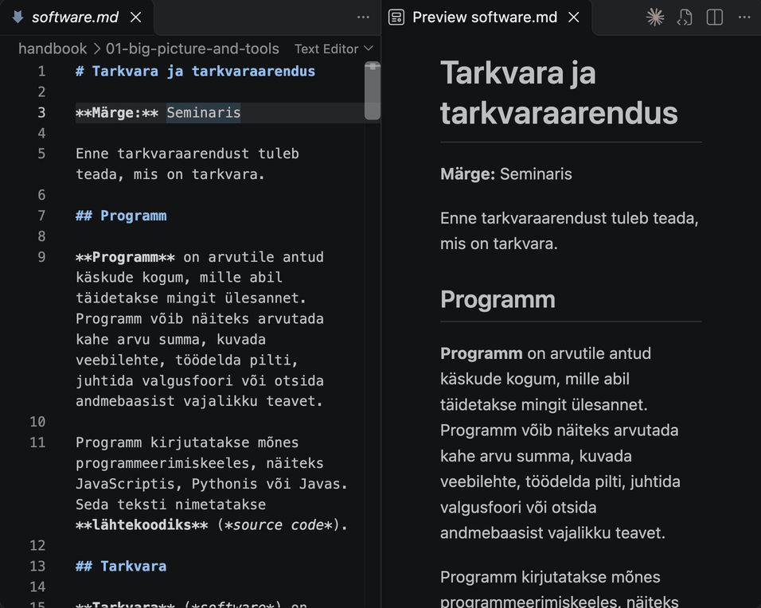
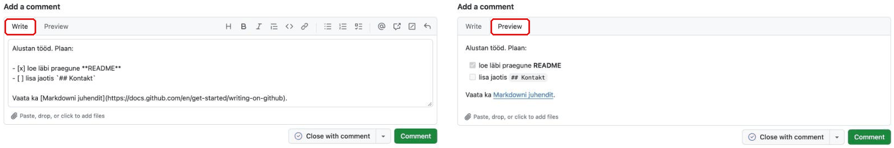

# Markdown

**Märge:** Seminaris

**Markdown** on lihtne märgistuskeel. Kirjutad tavalist teksti ja märgid mõne sümboliga, mis on pealkiri, loend või link. Markdown-faili laiend on `.md`.

## Miks Markdown?

- Lähteteksti on lihtne lugeda ka ilma vormindamata.
- Seda saab kirjutada igas tekstiredaktoris.
- Git näitab tekstifaili muudatusi rea kaupa. Wordi failiga see ei õnnestu.
- GitHub kuvab Markdowni vormindatud dokumendina.
- Sama süntaks töötab README-failides, Issue'des, pull request'ides ja kommentaarides.

Seepärast hoitakse tarkvaraprojekti dokumentatsioon tavaliselt Markdownina samas repos koodiga. Ka see konspekt on kirjutatud Markdownis.

Markdown kirjeldab dokumendi **struktuuri**, mitte kujundust. Fonti, värve ja joondust sellega ei määra.

## Kasutusjuhis

### VS Code'is

1. Ava VS Code'is projekti kaust.
2. Loo uus fail: Exploreris vajuta **New File** ja anna nimi, mis lõpeb laiendiga `.md`, näiteks `notes.md`.
3. Kirjuta faili tekst koos Markdowni märgistusega.
4. Ava eelvaade:
   - eraldi vahelehel: `Ctrl+Shift+V` (macOS-is `Cmd+Shift+V`);
   - teksti kõrval: `Ctrl+K V` (macOS-is `Cmd+K V`), st vajuta kõigepealt `Ctrl+K`, siis lase lahti ja vajuta `V`.
5. Salvesta fail: `Ctrl+S` (macOS-is `Cmd+S`).

Kõrvuti eelvaade uueneb kirjutamise ajal. Nii näed kohe, kas märgistus töötab.



### GitHubis

GitHub kuvab repo `.md` failid automaatselt vormindatuna. Kausta `README.md` näidatakse kausta avamisel failide loetelu all.

Issue'de, pull request'ide ja kommentaaride tekstiväljas on kaks vahelehte:

- **Write**: siia kirjutad Markdowni;
- **Preview**: siin näed tulemust enne salvestamist.



## Põhisüntaks

| Kirjutad | Tulemus |
|---|---|
| `# Pealkiri` | 1. taseme pealkiri |
| `## Alapealkiri` | 2. taseme pealkiri |
| `**paks**` | **paks** |
| `*kaldkiri*` | *kaldkiri* |
| `` `kood` `` | `kood` |
| `[GitHub](https://github.com)` | [GitHub](https://github.com) |
| `- punkt` | täpploendi punkt |
| `1. samm` | nummerdatud loendi punkt |
| `- [ ] ülesanne` | märkeruut (GitHubis) |
| `> tsitaat` | tsitaadiplokk |

### Näide

Kopeeri see faili ja ava eelvaade:

````markdown
# Minu projekt

Lühike kirjeldus, **mida** projekt teeb.

## Paigaldamine

1. Klooni repo.
2. Ava kaust VS Code'is.

## Käsud

```bash
git status
```

## Lingid

- [Giti dokumentatsioon](https://git-scm.com/doc)
- [Projekti Issue'd](https://github.com/omanik/repo/issues)
````

### Tabel

```markdown
| Tööriist | Milleks |
|---|---|
| Git | versioonihaldus |
| GitHub | koostöö |
```

Esimene rida on päis, teine rida eraldab päise sisust.

### Pilt

```markdown

```

Nurksulgudes olev tekst on **alt-tekst**. Ekraanilugeja loeb selle ette ja see kuvatakse, kui pilt ei lae. Kirjelda, mida pildil näha on.

### Esiletõst GitHubis

```markdown
> [!TIP]
> Kasulik nõuanne.

> [!WARNING]
> Hoiatus.
```

Teised variandid on `[!NOTE]`, `[!IMPORTANT]` ja `[!CAUTION]`.

## Levinud vead

| Viga | Parandus |
|---|---|
| `#Pealkiri` ei muutu pealkirjaks | Pane `#` järele tühik: `# Pealkiri` |
| Loend jääb tavaliseks tekstiks | Jäta loendi ette tühi rida |
| Kaks rida sulavad üheks | Jäta lõikude vahele tühi rida |
| Pilti ei kuvata | Kontrolli failiteed ja suur- ja väiketähti |

Hea tava on, et failis on üks `#` pealkiri ja alapealkirjad lähevad järjest (`##`, siis `###`).

Täielik süntaks on [GitHubi juhendis](https://docs.github.com/en/get-started/writing-on-github/getting-started-with-writing-and-formatting-on-github/basic-writing-and-formatting-syntax).

## Kontrolli ennast

1. Miks hoitakse tarkvaraprojekti dokumentatsioon Markdownina repos, mitte Wordi failina?
2. Loo VS Code'is fail `test.md`, kus on pealkiri, loend, link ja tabel. Ava eelvaade ja kontrolli, et kõik kuvatakse õigesti.

*Kuvatõmmised seisuga: november 2026.*

---

[← Git ja GitHub](04-git-and-github.md) | [Sisukord](../README.md) | [Järgmine: Arenduskeskkond →](06-dev-environment.md)
