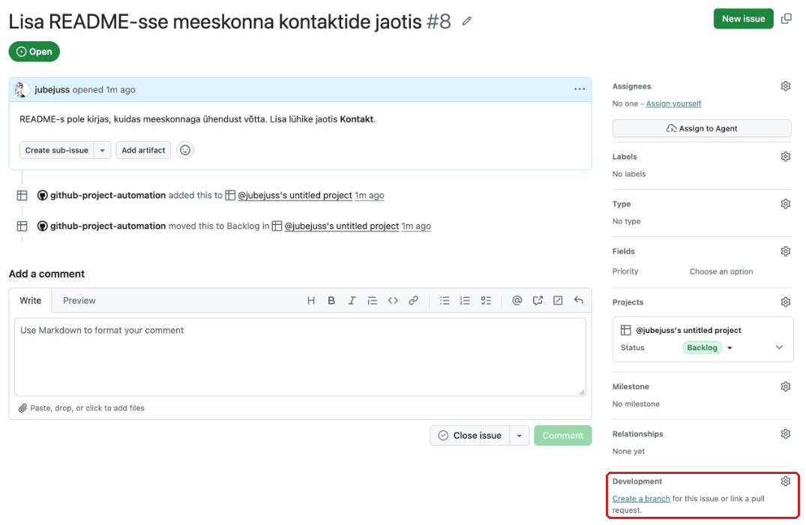
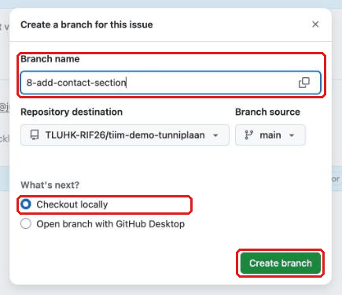
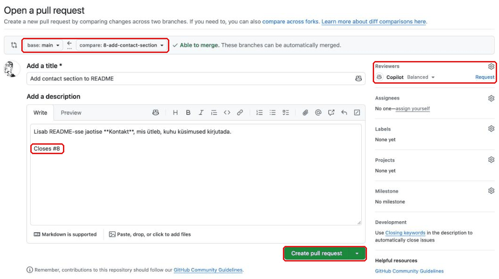
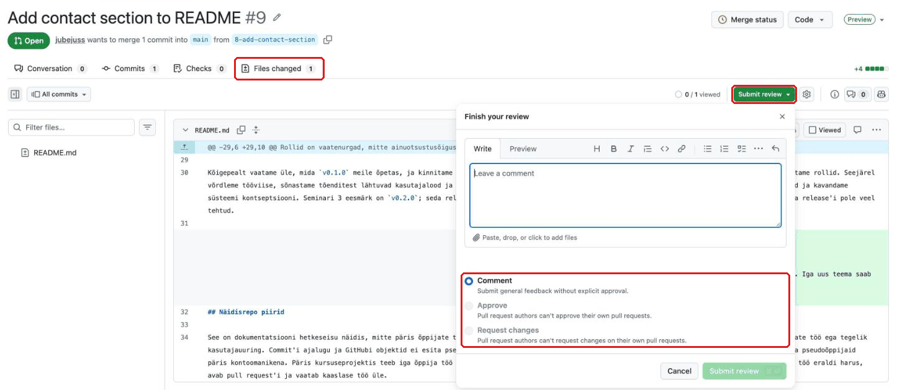

# Giti oskus: harud

**Märge:** Seminaris

Meeskonnas ei muudeta otse projekti põhiversiooni. Iga töö tehakse eraldi harus ja vaadatakse enne ühendamist üle. See leht näitab seda töövoogu algusest lõpuni.

```text
Issue → haru → commit → push → pull request → ülevaatus → merge
```

## Haru

**Haru** (*branch*) on repo eraldi tööliin. Harus tehtud muudatused ei mõjuta **peaharu** (`main` või `master`) enne, kui need on üle vaadatud ja ühendatud.

```text
main                  ●───●───────────────●   ← ühendatud töö
                           \             /
8-add-contact-section       ●───●───●───●     ← sinu töö harus
```

Harud võimaldavad mitmel inimesel korraga töötada nii, et keegi ei sega teist ja peaharu jääb kogu aeg töökorda.

Kasulikud käsud:

```bash
git branch --show-current            # millises harus oled
git switch main                      # mine peaharusse
git switch -c 8-add-contact-section  # loo uus haru ja mine sinna
```

VS Code näitab aktiivset haru akna allservas.

### Vahepala: `master` või `main`?

Peaharu nimi on repos kas `master` või `main`. Tähendus on sama, erineb ainult nimi.

- Git nimetas esimese haru algusest peale `master`. Arvatakse, et nimi pärineb varasemast versioonihaldustööriistast BitKeeper, kus kasutati sõnapaari *master/slave* (peremees ja ori).
- 2020. aastal hakkasid platvormid nime muutma, sest see sõnapaar seostub orjandusega. GitHub kasutab alates oktoobrist 2020 uute repode peaharu nimena `main`. GitLab ja Bitbucket tegid sama.
- Git ise nimetab käsuga `git init` loodud repo esimese haru endiselt `master`, kui sa pole seda muutnud. Alates Giti versioonist 2.28 saab vaikimisi nime ise valida:

```bash
git config --global init.defaultBranch main
```

Vanemates projektides on sageli `master`, uutes `main`. Kontrolli oma repo peaharu nime käsuga `git branch` ja kasuta käskudes seda nime.

## Issue

**Issue** on GitHubis kirja pandud ülesanne, viga või küsimus. Igal Issue'l on number, näiteks `#8`. Issue'st algab töö: selles on kirjas, mida on vaja teha ja miks.

## Töövoog samm-sammult

### 1. Loo haru Issue'st

1. Ava Issue GitHubis.
2. Paremas veerus osas **Development** vajuta **Create a branch**.
3. GitHub pakub nime, mis algab Issue numbriga, näiteks `8-add-contact-section`. Jäta number alles.
4. Vali **Checkout locally** ja vajuta **Create branch**.
5. Kopeeri GitHubi pakutud käsud ja käivita need repo kaustas:

```bash
git fetch origin
git checkout 8-add-contact-section
```

`git fetch origin` toob uue haru info arvutisse ja `git checkout` võtab haru kasutusele. Nii jääb Issue ja haru seos GitHubis nähtavaks.

Kui lood haru terminalis käsuga `git switch -c`, kasuta sama kuju: kõigepealt Issue number, siis lühike ingliskeelne kirjeldus väiketähtede ja sidekriipsudega, näiteks `8-add-contact-section`.





### 2. Tee muudatus, commit ja push

Tee muudatus ja commit nagu lehel [esimene commit](git-first-commit.md). Uue haru esimesel push'il ütle Gitile, kuhu haru GitHubis saata:

```bash
git push -u origin 8-add-contact-section
```

`-u` seob kohaliku haru GitHubi haruga. Edaspidi piisab samas harus käsust `git push`.

### 3. Ava pull request

**Pull request** (PR) on palve muudatus üle vaadata ja peaharusse ühendada.

1. Ava repo GitHubis. Pärast push'i pakub GitHub nuppu **Compare & pull request**.
2. Kontrolli, et siht (**base**) on peaharu ja allikas (**compare**) sinu haru.
3. Kirjuta pealkiri ja paar lauset, mida muutsid.
4. Lisa kirjeldusse eraldi reale `Closes #8`. See seob PR-i Issue'ga ja sulgeb Issue ühendamisel.
5. Vali paremal **Reviewers** alt ülevaataja.
6. Vajuta **Create pull request**.



### 4. Ülevaatus

Ülevaataja avab PR-i vahekaardi **Files changed**, loeb muudatuse läbi ja kommenteerib. Lõpuks vajutab ta **Submit review** ja valib:

- **Approve:** muudatus sobib;
- **Request changes:** midagi olulist tuleb parandada;
- **Comment:** ainult küsimus, ülevaatus ei ole lõpetatud.

Hea ülevaatus on rohkem kui „Korras”:

- ülevaataja esitab vähemalt ühe sisulise küsimuse või ettepaneku;
- autor vastab igale kommentaarile enne ühendamist: mida muutis või miks jättis muutmata.

Ülevaatus, mis koosneb ainult sõnast „OK”, ei näita, et keegi töö läbi luges.

Autor parandab samas harus, teeb uue commit'i ja `git push`. PR uueneb ise, uut PR-i pole vaja.



Koodi ülevaatusest räägime täpsemalt osas 4.

### 5. Merge

Pärast heakskiitu ühendab PR-i peaharusse **keegi teine kui autor**: **Merge pull request**. Nii on kindel, et vähemalt kaks inimest on muudatust näinud. Muudatus on nüüd peaharus ja Issue suletakse.

## `.gitignore`

Kõiki faile ei tohi repo'sse panna. Fail **`.gitignore`** repo juurkaustas ütleb Gitile, milliseid faile mitte jälgida. Näiteks:

```text
# operatsioonisüsteemi failid
.DS_Store
Thumbs.db

# paroolid ja võtmed
.env

# sõltuvused ja ehitatud failid
node_modules/
dist/
```

Igal real on failinimi või muster. `*.log` tähendab kõiki `.log` laiendiga faile. `#` algab kommentaar.

`.gitignore` ei eemalda faili, mis on juba commit'itud. Lisa see fail seepärast projekti algusesse.

## Clone ja fork

- **Clone** kopeerib GitHubi repo sinu arvutisse. Seda teed, kui sul on repo'sse kirjutamise õigus, näiteks meeskonna repo puhul.
- **Fork** kopeerib teise omaniku repo sinu GitHubi konto alla. Seda tehakse, kui sul pole kirjutamisõigust, näiteks avatud lähtekoodiga projektis.

```text
algne repo → fork sinu kontol → clone sinu arvutisse → PR algsele repole
```

Meeskonnaprojektis kloonime ühise repo ja töötame harudes. Forki puhul piisab, kui mõistad, milleks seda kasutatakse.

## Kontrolli ennast

1. Miks ei tehta muudatusi otse peaharusse?
2. Mida teeb rida `Closes #8` pull request'i kirjelduses?
3. Mis vahe on valikutel **Approve**, **Request changes** ja **Comment**?
4. Milliseid faile ei tohi repo'sse panna ja kuidas seda vältida?
5. Läbi kogu töövoog: Issue → haru → commit → push → PR. Kontrolli GitHubis, et Issue lehel on näha sinu haru ja PR.

*Kuvatõmmised seisuga: november 2026.*

---

[← Giti oskus: esimene commit](git-first-commit.md) | [Sisukord](../README.md) | [Järgmine osa: Kliendisoovist arendusülesandeni →](../02-from-request-to-task/README.md)
