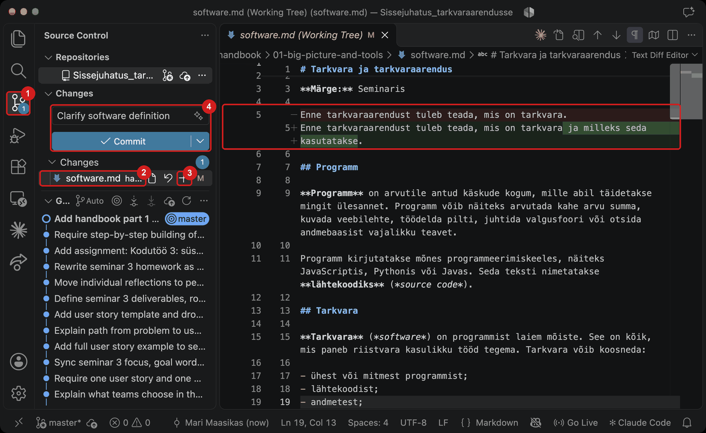
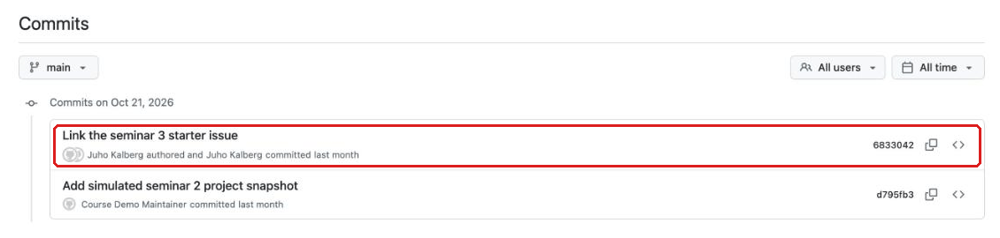

# Giti oskus: esimene commit

**Märge:** Seminaris

See leht näitab Giti põhiringi: muudad faili, salvestad muudatuse Giti ajalukku ja saadad selle GitHubi. Teeme selle kõigepealt terminalis ja vaatame sama tegevust VS Code'is.

## Kolm sammu, kolm kohta

Gitis liigub muudatus läbi kolme koha:

```text
töökaust            ettevalmistusala         kohalik repo            GitHub
(muudetud failid) ──► (valitud muudatused) ──► (commit'id) ──────────► (kaugrepo)
              git add                  git commit             git push
```

- **Töökaust:** failid, mida VS Code'is muudad.
- **Ettevalmistusala** (*staging area*): muudatused, mille oled järgmisse commit'i valinud.
- **Kohalik repo:** commit'id sinu arvuti Giti ajaloos.
- **GitHub:** kaugrepo, kus teised sinu tööd näevad.

> [!IMPORTANT]
> Faili salvestamine ei loo commit'i. Commit ei saada midagi GitHubi. Iga samm tuleb teha eraldi.

## Terminalis

Ava terminal repo kaustas. Kontrolli kõigepealt olukorda:

```bash
git status
```

`git status` näitab, millises harus oled ja millised failid on muutunud. Uus fail on märgitud kui **untracked**: Git veel ei jälgi seda.

Seejärel tee järgmised käsud ükshaaval:

```bash
git add README.md
git diff --cached
git commit -m "Add personal introduction"
git push
```

| Käsk | Mida teeb |
|---|---|
| `git add README.md` | valib faili järgmisse commit'i |
| `git diff --cached` | näitab, mida oled valinud; väljud klahviga `q` |
| `git commit -m "..."` | salvestab valitud muudatused kohalikku ajalukku koos sõnumiga |
| `git push` | saadab commit'id GitHubi |

Asenda `README.md` failiga, mida muutsid.

### Commit'i sõnum

Sõnum ütleb, **mida muudatus teeb**. Kursusel kirjutame sõnumid inglise keeles ja alustame tegusõnaga:

- hea: `Add personal introduction`, `Fix broken link in README`;
- halb: `update`, `changes`, `asdf`.

Commit'i heast tavast räägime täpsemalt osas 2.

## VS Code'is

Sama ringi saab teha VS Code'i **Source Control** vaates. VS Code käivitab taustal samad Giti käsud.



1. Ava vasakult **Source Control**. **Changes** all on muudetud failid.
2. Klõpsa failil: avaneb võrdlus, kus punane on eemaldatud ja roheline lisatud tekst.
3. Vajuta faili kõrval `+`. Fail liigub **Staged Changes** alla (sama mis `git add`).
4. Kirjuta sõnumi väljale commit'i sõnum ja vajuta **Commit** (sama mis `git commit`).
5. Vajuta **Sync Changes** või **Push** (sama mis `git push`).

## Kontrolli GitHubis

Ava repo brauseris. Faili uus sisu peab olema näha ja failide loetelu kohal on sinu viimase commit'i sõnum. Lingilt **Commits** näed kogu ajalugu.



## Enne commit'i kontrolli

- Kas commit'is on ainult need failid, mida soovid?
- Kas failis pole paroole, võtmeid ega isikuandmeid? Kord GitHubi saadetud info jääb ajalukku ka siis, kui faili hiljem muudad.

## Kui midagi läheb valesti

| Olukord | Mida teha |
|---|---|
| Git küsib nime ja e-posti | Seadista need: vaata lehte [Git ja GitHub](git-and-github.md#giti-paigaldamine) |
| `git push` annab vea | Loe veateade läbi ja peatu. Ära kasuta käsku `git push --force`. |
| `git diff` avas keritava vaate | Välju klahviga `q` |

## Kontrolli ennast

1. Mis vahe on faili salvestamisel, commit'il ja push'il?
2. Mida teeb `git add`?
3. Muuda oma repos üht faili ja vii muudatus terminalis GitHubi. Kontrolli GitHubis, et commit on seal.

*Kuvatõmmised seisuga: november 2026.*

---

[← Arenduskeskkond](dev-environment.md) | [Sisukord](../README.md) | [Järgmine: Giti oskus: harud →](git-branches.md)
