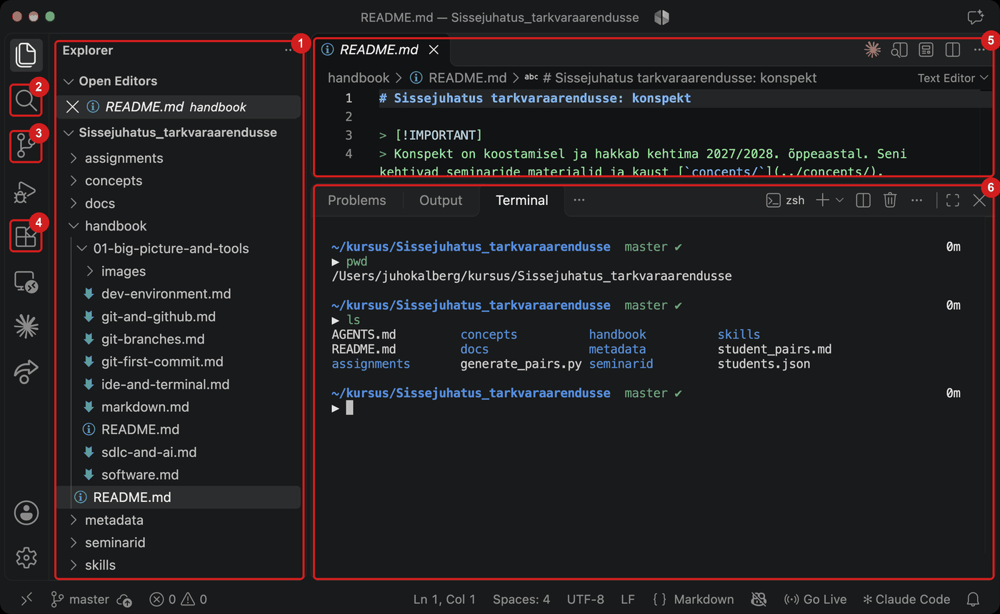
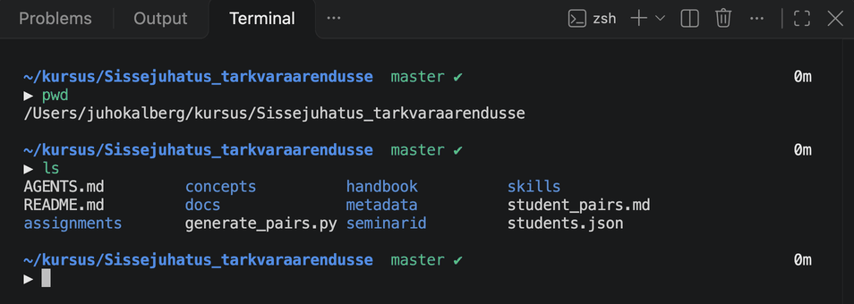

# IDE ja terminal

**Märge:** Seminaris

## Arendaja töövahendid

Tarkvara arendamisel kasutatakse mitut tööriista. Igal neist on oma ülesanne ja need ei asenda üksteist.

| Tööriist | Milleks |
|---|---|
| VS Code | projekti failide ja koodi muutmine |
| Terminal | programmide käivitamine tekstikäskudega |
| Git | failide muudatuste ajaloo haldamine |
| GitHub | repositooriumide hoidmine veebis ja meeskonnatöö |
| Markdown | dokumentatsiooni kirjutamine |
| GitHub Projects, Jira | tööde ja vastutajate planeerimine |
| Node.js, npm, Docker | rakenduste käivitamine ja arenduskeskkonna loomine |

See leht tutvustab kahte tööriista, mida kasutad iga päev: koodiredaktorit ja terminali.

## Tekstiredaktor, koodiredaktor ja IDE

**Tekstiredaktor**, näiteks Notepad või TextEdit, muudab ühte faili korraga. See ei tea, et fail on osa projektist.

**IDE** (*Integrated Development Environment*, integreeritud arenduskeskkond) koondab ühte programmi kõik, mida arendaja vajab:

- koodiredaktori koos värvide, vihjete ja vigade märkimisega;
- projekti failide halduse;
- koodi käivitamise ja silumise ehk vigade otsimise;
- terminali;
- versioonihalduse.

**VS Code** (Visual Studio Code) on ametlikult koodiredaktor, kuid laienduste abil saab sellest tervikliku arenduskeskkonna. Kursusel kasutame VS Code'i. Selle saad alla laadida aadressilt [code.visualstudio.com](https://code.visualstudio.com/).

Teised levinud valikud on näiteks JetBrainsi IDE-d (IntelliJ IDEA, WebStorm, PyCharm), Cursor ja Sublime Text. Põhimõtted on kõigis sarnased.

### VS Code'i põhiosad

| Nr | Osa | Mida teeb |
|---|---|---|
| 1 | **Explorer** | näitab projekti kaustu ja faile |
| 2 | **Search** | otsib teksti kõigist projekti failidest |
| 3 | **Source Control** | näitab Giti muudatusi |
| 4 | **Extensions** | paigaldab lisavõimalusi |
| 5 | **Redaktor** | siin avad ja muudad faile |
| 6 | **Terminal** | käsurida VS Code'i sees |

VS Code'is avatakse alati terve **projekti kaust**, mitte üksik fail: **File → Open Folder**. Siis näeb VS Code kõiki projekti faile ja tunneb ära Giti repositooriumi.

## Terminal ja käsukest

**Terminal** on aken, kuhu kirjutad tekstikäske ja näed nende väljundit.

**Käsukest** (*shell*) on programm, mis neid käske tõlgendab. Levinud käsukestad on Bash, Zsh ja PowerShell.

Terminal ei ole Git. Git, Node.js ja Docker on eraldi programmid, mida terminalist käivitatakse.

### Miks terminal, kui on graafilised tööriistad?

Graafilised tööriistad, näiteks VS Code'i Source Control vaade, teevad taustal samu käske, mida saad terminali kirjutada. Terminal on kasulik, sest:

- käsk teeb täpselt seda, mida kirjutad, ja väljund näitab, mis juhtus;
- samad käsud töötavad igas arvutis ja serveris, ka seal, kus graafilist liidest pole;
- dokumentatsioon ja veateated viitavad enamasti käskudele.

Kursusel teeme Giti töö terminalis ja vaatame sama tulemust paralleelselt VS Code'is.

### Terminal VS Code'is

Ava terminal menüüst **Terminal → New Terminal**. Terminal avaneb projekti kaustas.

**Windowsis** kasutame Git Bashi, sest kursuse käsud on Bashi kujul. Git Bash paigaldatakse koos Gitiga. Vali see VS Code'is vaikimisi terminaliks:

1. Vajuta terminalipaneelil `+` kõrval olevale noolele.
2. Vali **Select Default Profile**.
3. Vali **Git Bash** ja ava uus terminal.

**macOS-is** sobib vaikimisi Zsh ja **Linuxis** Bash või Zsh.

### Esimesed käsud

| Käsk | Mida teeb |
|---|---|
| `pwd` | näitab, millises kaustas oled |
| `ls` | näitab kausta sisu |
| `cd kausta-nimi` | liigub kausta |
| `cd ..` | liigub ühe taseme võrra üles |
| `mkdir kausta-nimi` | loob uue kausta |
| `clear` | puhastab terminaliakna |
| `git --version` | näitab, kas Git on paigaldatud |

Kaks nippi säästavad palju aega:

- **Tab** lõpetab faili- või kaustanime ise.
- **Nool üles** toob tagasi eelmise käsu.

> [!WARNING]
> Ära kopeeri terminali käsku, mille tähendusest sa aru ei saa. Käsk võib kustutada faile või muuta süsteemi seadeid.

## Kontrolli ennast

1. Mis vahe on tekstiredaktoril ja IDE-l?
2. Mis vahe on terminalil ja käsukestal?
3. Ava VS Code'is kaust ja terminal. Näita käsuga, millises kaustas oled ja mis seal on.

*Kuvatõmmised seisuga: november 2026.*

---

[← Tarkvaraarenduse elutsükkel ja AI](sdlc-and-ai.md) | [Sisukord](../README.md) | [Järgmine: Git ja GitHub →](git-and-github.md)
