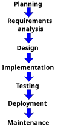
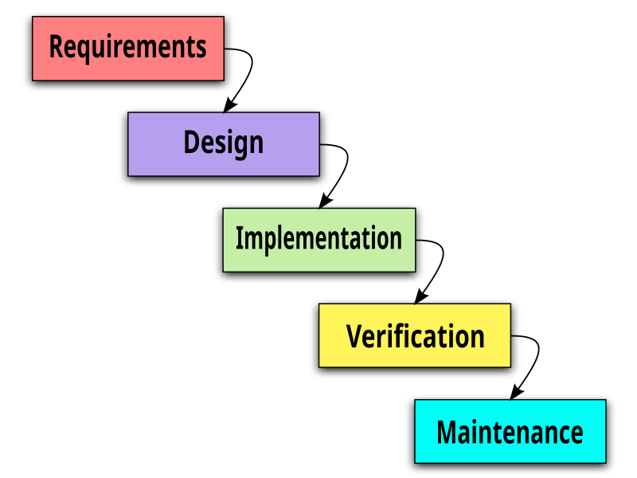
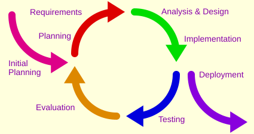

# Tarkvaraarenduse elutsükkel ja AI

**Märge:** Seminaris

## Elutsükkel

**Tarkvaraarenduse elutsükkel** ehk **SDLC** (*Software Development Life Cycle*) kirjeldab tegevusi, mida on vaja tarkvara loomiseks ja käigus hoidmiseks.

1. **Probleemi mõistmine:** kelle probleem see on ja miks tasub seda lahendada?
2. **Uurimine ja nõuded:** mida kasutajad vajavad ja mida süsteem peab tegema?
3. **Planeerimine:** kes, mida, millal ja milliste vahenditega teeb?
4. **Disain:** kuidas lahendus töötab ja kuidas kasutaja seda kasutab?
5. **Arendamine:** lahendus ehitatakse ja kood kirjutatakse.
6. **Testimine:** kontrollitakse, kas tarkvara töötab õigesti, turvaliselt ja töökindlalt.
7. **Avaldamine:** tarkvara tehakse kasutajatele kättesaadavaks.
8. **Kasutamine ja hooldus:** vigu parandatakse, tööd jälgitakse ja lisatakse uusi võimalusi.

*Joonis: [Wikimedia Commons](https://commons.wikimedia.org/wiki/File:Systems_development_life_cycle.svg), [CC0 1.0](https://creativecommons.org/publicdomain/zero/1.0/).*

Päris arendus ei liigu sirgjooneliselt. Testimine võib näidata, et disaini tuleb muuta, ja kasutajate tagasiside võib muuta nõudeid. Hoolduse käigus algab sageli uus arendusring.

## Waterfall ja iteratiivne arendus

**Waterfall** ehk **kosemudel** korraldab töö järjestikuste etappidena. Järgmine etapp algab siis, kui eelmine on lõpetatud.

*Joonis: Paul Smith / [Wikimedia Commons](https://commons.wikimedia.org/wiki/File:Waterfall_model_(1).svg), [CC BY 3.0](https://creativecommons.org/licenses/by/3.0/).*

**Iteratiivses arenduses** luuakse lahendus lühikeste korduvate ringidena. Igas ringis planeeritakse, tehakse, testitakse ja hinnatakse tulemust.

*Joonis: Aflafla1 / [Wikimedia Commons](https://commons.wikimedia.org/wiki/File:Iterative_development_model.svg), [CC0 1.0](https://creativecommons.org/publicdomain/zero/1.0/).*

Iteratiivse arendusega käib sageli kaasas **järkjärguline** ehk **inkrementaalne** arendus: töötavale lahendusele lisatakse uusi võimalusi samm-sammult.

**Agiilne arendus** on laiem tööpõhimõtete kogum. Selle keskmes on sage koostöö, tagasiside ja valmisolek plaani uue info põhjal muuta. Agiilne ei tähenda, et plaani, dokumentatsiooni või kvaliteedikontrolli pole.

Kumbki lähenemine ei sobi igale poole:

- Waterfall sobib, kui nõuded on hästi teada ja hilised muudatused on kallid.
- Iteratiivne ja agiilne arendus sobivad, kui nõuded on ebaselged ja kasutajatelt saab kiiresti tagasisidet.

Tööviise võrdleme põhjalikumalt osas 3.

### MVP

**MVP** (*Minimum Viable Product*, väikseim elujõuline toode) on väikseim kasutatav versioon, millega saab kontrollida, kas lahendus on vajalik.

Näiteks ülesannete haldamise rakenduse MVP võimaldab ainult ülesannet lisada, nimekirja vaadata ja ülesande tehtuks märkida. Meeldetuletused ja rühmatöö tulevad hiljem, kui kasutajad on rakendust proovinud.

MVP ei ole katkine ega poolik toode. Põhiline töövoog peab algusest lõpuni toimima.

## AI tarkvaraarenduses

AI ei ole ainult koodi kirjutamise tööriist. See võib toetada peaaegu iga elutsükli etappi.

| Etapp | Kuidas AI aitab | Mida inimene kontrollib |
|---|---|---|
| Uurimine | koondab infot, pakub küsimusi | allikaid, kallutatust, päris kasutajavajadust |
| Nõuded | sõnastab, rühmitab, leiab vastuolusid | kas nõue vastab päris probleemile |
| Disain | pakub lahendusideid ja kasutusvoogusid | kasutatavust ja ligipääsetavust |
| Programmeerimine | kirjutab, selgitab ja parandab koodi | kas kood töötab, on turvaline ja arusaadav |
| Testimine | pakub testjuhtumeid ja piirjuhte | kas testid on piisavad |
| Dokumenteerimine | koostab mustandeid ja kokkuvõtteid | kas tekst vastab tegelikule süsteemile |

> [!IMPORTANT]
> AI võib teha töö kiiremaks, kuid ei vastuta tulemuse eest. Mida ehitada, kuidas tööd jagada ja kas tulemus kõlbab, otsustab meeskond.

### Riskid

- **Vigased vastused:** AI vastus võib kõlada veenvalt ja olla ikkagi vale.
- **Konfidentsiaalne info:** ära sisesta avalikku AI-teenusesse paroole, API võtmeid ega ettevõtte lähtekoodi.
- **Privaatsus:** ära sisesta teiste inimeste isikuandmeid.
- **Turvalisus:** AI loodud koodis võib olla turvaauke.
- **Autoriõigus ja litsentsid:** loodud tekst või kood võib sarnaneda kellegi teise kaitstud tööga.
- **Kallutatus:** AI kordab andmetes olevaid eelarvamusi.

Kontrolli AI loodud koodi, viiteid ja väiteid. Uuri enne kasutamist projekti või tööandja reegleid. Ole valmis selgitama iga oma töö osa, ka seda, mille aitas teha AI.

## Kontrolli ennast

1. Nimeta elutsükli etapid ja selgita, miks arendus ei liigu alati järjest.
2. Millal sobib Waterfall ja millal iteratiivne arendus?
3. Mis on MVP ja miks see ei tähenda poolikut toodet?
4. Kui AI kirjutab töötava koodi, siis kes vastutab, et see on turvaline ja vastab kasutaja vajadusele?

---

[← Tarkvara ja tarkvaraarendus](software.md) | [Sisukord](../README.md) | [Järgmine: IDE ja terminal →](ide-and-terminal.md)
