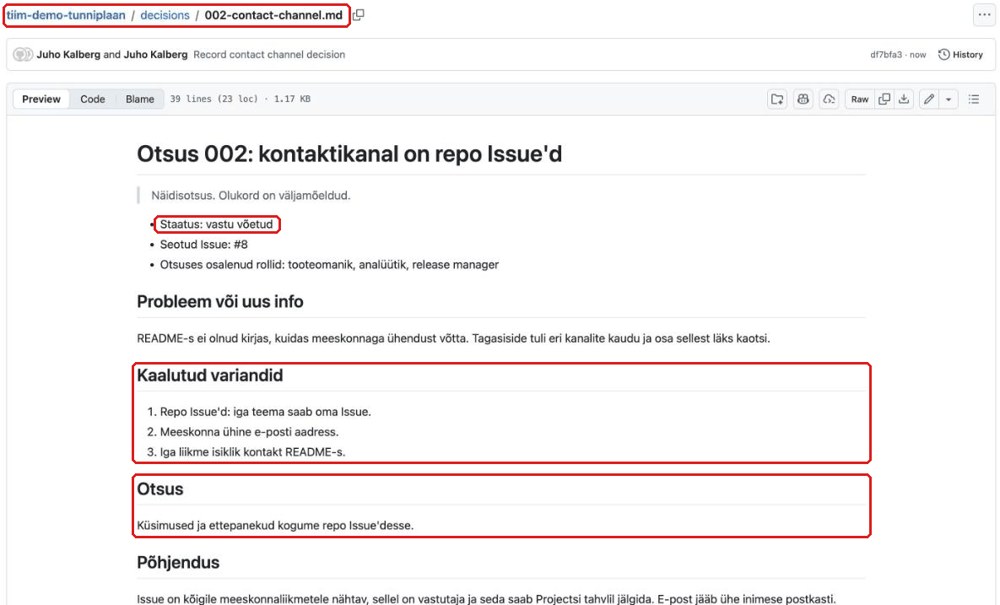

# Dokumenteerimine

**Märge:** Seminaris

Dokumentatsioon vastab küsimustele, mida koodist ei loe: miks see projekt on olemas, kuidas sellega alustada ja miks tehti just need valikud. Tarkvaraprojektis hoitakse dokumentatsioon Markdowni failidena samas repos, kus kood. Nii muutub see koos projektiga ja läbib sama ülevaatuse.

## README

`README.md` on projekti esileht. GitHub näitab seda repo avamisel kohe failide all.

Hea README vastab lühidalt:

- **Mis projekt see on?** Üks-kaks lauset eesmärgist.
- **Kes selles osalevad?** Meeskond ja rollid.
- **Kus on olulised failid?** Lingid otsustele, uurimusele ja release'idele.
- **Mis on hetkeseis?** Mis on tehtud ja mis tuleb järgmisena.

Hoia README lühike. Pikem sisu läheb eraldi failidesse, millele README viitab.

## Otsuste logi

**Otsuste logi** on kaust, kus iga oluline otsus on eraldi failis. Tarkvaratööstuses nimetatakse selliseid faile ka ADR-ideks (*Architecture Decision Record*).

Otsuste logi on kursuse projekti keskne dokument, sest see säilitab otsuse **põhjenduse**. Koodist ja failidest näeb, *mis* tehti. Otsuste logist näeb, *miks* tehti ja millest loobuti. Pool aastat hiljem ei mäleta seda keegi peast.

Failid nummerdatakse järjekorras:

```text
decisions/
├── 001-problem-choice.md
├── 002-way-of-working.md
└── 003-quality-priorities.md
```

### Otsuse osad

| Osa | Küsimus |
|---|---|
| **Staatus** | Kas otsus on pakutud, vastu võetud, muudetud või tühistatud? |
| **Probleem või uus info** | Mis tekitas vajaduse otsustada? |
| **Kaalutud variandid** | Millised valikud olid laual? |
| **Otsus** | Mida valisime? |
| **Põhjendus** | Miks see valik sobib paremini kui teised? |
| **Mõju ja riskid** | Millest loobume ja milline risk jääb alles? |
| **Kontrollimine** | Kuidas saame hiljem teada, kas otsus oli õige? |
| **AI kasutamine** | Kui AI mõjutas otsust: milleks seda kasutati, mida kontrolliti ja mis oli kasu? |

Vana otsust ei kustutata. Kui otsus muutub, kirjuta uus otsus ja märgi vanale staatuseks „muudetud” koos viitega uuele. Nii jääb alles, kuidas meeskonna arusaam arenes.



Faili nimi on inglise keeles, sisu eesti keeles.

## Kus mis asub

| Fail või kaust | Sisu |
|---|---|
| `README.md` | projekti esileht |
| `decisions/` | otsuste logi |
| `research/` | uurimismärkmed ja tõendid |
| `releases/` | iga avaldatud versiooni kokkuvõte |

Kui failid on loogiliselt paigas, leiab uus liige vajaliku ise üles.

## Kontrolli ennast

1. Mis vahe on README-l ja otsuste logil?
2. Miks ei kustutata vana otsust, kui see muutub?
3. Ava mõne avatud lähtekoodiga projekti README GitHubis. Millele see vastab ja mis on puudu?

*Kuvatõmmised seisuga: november 2026.*

---

[← Lähteülesanne](04-project-brief.md) | [Sisukord](../README.md) | [Järgmine: Kanban ja ajahinnang →](06-kanban-and-estimates.md)
