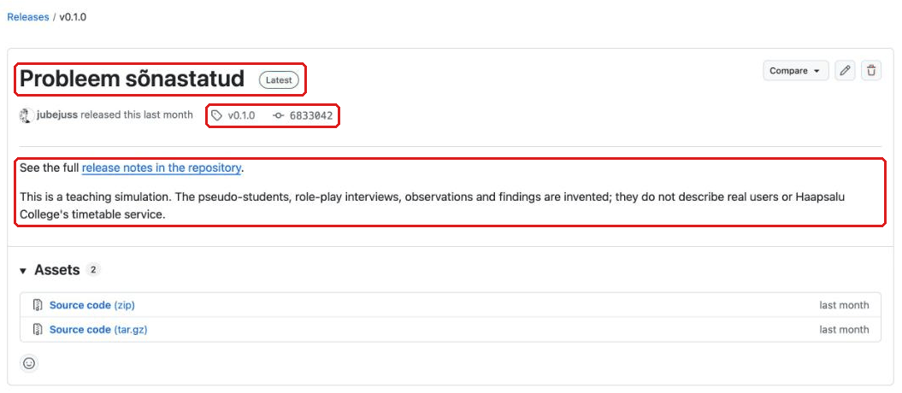
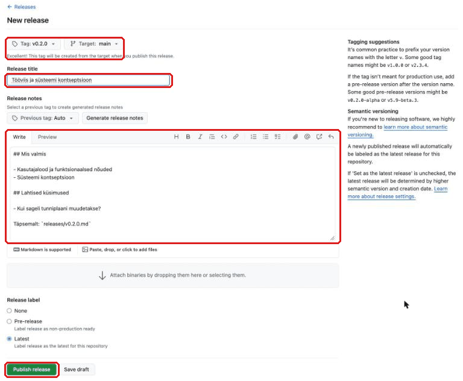

# Giti oskus: pull ja release

**Märge:** Seminaris

Osas 1 töötasid oma repos. Meeskonnas on üks ühine repo, kuhu kõik oma töö pull request'iga ühendavad. Selle lehe uued oskused on kaaslaste töö toomine oma arvutisse (`pull`) ja etapi tulemuse avaldamine versioonina (release).

## Töö ühises repos

```text
1. klooni ühine repo (üks kord)
2. loo oma Issue ja haru
3. commit → push → pull request → ülevaatus → merge
4. uuenda oma main-haru (git pull)
5. järgmine Issue algab uuendatud main-ist
```

Sammud 2–3 on samad mis osas 1, vaata [Giti oskus: harud](../01-big-picture-and-tools/git-branches.md). Igaüks töötab oma harus ja oma failides, nii et tööd ei sega üksteist.

## Head commit'id

Meeskonnas loevad sinu commit'e teised. Hea commit teeb nende töö lihtsamaks:

- **Üks commit, üks loogiline muudatus.** Ära pane ühte commit'i kokku seostamata töid.
- **Sõnum ütleb, mida muudatus teeb.** Inglise keeles, algab tegusõnaga: `Add interview questions`, `Clarify problem impact`.
- **Pealkiri on lühike**, umbes 50 tähemärki, lõpus punkti pole.
- **Põhjenduse saab lisada** pealkirja alla pärast tühja rida, kui „miks” pole ilmne.

```text
Clarify timetable access issue

Interview notes showed that evening students often check
room changes from a phone while travelling to school.
```

Halvad sõnumid on näiteks `update`, `fix`, `changes`: need ei ütle, mida muudeti.

## git pull

Kui kaaslase PR on ühendatud, on GitHubis `main` uuem kui sinu arvutis. Uuenda oma koopiat:

```bash
git switch main
git pull --ff-only
```

| Käsk | Mida teeb |
|---|---|
| `git switch main` | läheb peaharusse |
| `git pull --ff-only` | toob GitHubist uued commit'id ja lisab need sinu `main`-i |

`--ff-only` tähendab, et Git ainult kerib sinu haru edasi. Kui sinu `main`-is on midagi, mida GitHubis pole, annab Git vea, selle asemel et muudatusi segi ajada. Algajale on see kõige turvalisem viis.

> [!TIP]
> Enne `pull`-i kontrolli käsuga `git status`, et sul pole commit'imata muudatusi. Järgmise töö haru loo alati äsja uuendatud `main`-ist.

VS Code'is teeb sama **Source Control → ... → Pull** või allservas olev sünkroniseerimise nupp.

## Tag ja release

**Tag** on nimi, mis on kinnitatud ühele kindlale commit'ile, näiteks `v0.1.0`. Erinevalt harust tag ei liigu: see näitab alati sama seisu.

**Release** on GitHubi leht, mis lisab tag'ile kirjelduse: mis selles versioonis on ja mis muutus. Nii saab hiljem vaadata, milline oli projekt just selle etapi lõpus.



### Semantiline versioonimine

Versiooninumber on kujul `MAJOR.MINOR.PATCH`, näiteks `1.4.2`:

| Osa | Suureneb, kui | Näide |
|---|---|---|
| **MAJOR** | muudatus ei ühildu varasemaga | `1.4.2` → `2.0.0` |
| **MINOR** | lisandub uus võimalus | `1.4.2` → `1.5.0` |
| **PATCH** | parandatakse viga | `1.4.2` → `1.4.3` |

Versioonid `0.x.y` tähendavad, et projekt on alles arenduses. `1.0.0` on esimene valmis versioon. Seda reeglistikku nimetatakse [semantiliseks versioonimiseks](https://semver.org/) (*Semantic Versioning*).

Kursusel avaldab meeskond iga etapi lõpus ühe `0.x.0` versiooni ja eksamil `1.0.0`.

### Release'i loomine

Release'i loob meeskonna **release manager**, kui kõik etapi PR-id on ühendatud:

1. Ava repo lehel **Releases** ja vajuta **Draft a new release**.
2. Vajuta **Tag: Select tag**, kirjuta uus versioon, näiteks `v0.2.0`, vali **Create new tag** ja kinnita **Create**. Tag luuakse alles avaldamisel. **Target** jääb `main`.
3. Lisa pealkiri ja lühike kirjeldus: mis valmis, mis muutus, mis jäi lahtiseks.
4. Vajuta **Publish release**. **Save draft** salvestab ainult mustandi ega avalda release'i.



Avaldatud tag'i ei muudeta ega tõsteta. Uus töö saab järgmise versiooninumbri.

### Release manageri kontrollnimekiri

Enne avaldamist loeb release manager tervikut nagu võõras lugeja:

- [ ] Iga release'i kirjelduse väide on failides tõesti olemas.
- [ ] Topeltfaile ja kohatäiteid („[kirjuta siia …]”) pole.
- [ ] AI juhised ja mustandimärked on eemaldatud.
- [ ] README viitab uutele otsustele ja failidele.
- [ ] Kõik etapi PR-id on üle vaadatud ja ühendatud.

Kui midagi on puudu, parandatakse see enne avaldamist. Lahtine küsimus võib release'i jääda, kui see on ausalt kirjas.

## Kontrolli ennast

1. Miks loob järgmise töö haru alati äsja uuendatud `main`-ist?
2. Mis vahe on harul ja tag'il?
3. Projekt on versioonil `0.3.0` ja lisandub uus võimalus. Mis on järgmine versioon?
4. Kirjuta commit'i sõnum muudatusele, mis parandab README-s katkise lingi.

*Kuvatõmmised seisuga: november 2026.*

---

[← Kanban ja ajahinnang](kanban-and-estimates.md) | [Sisukord](../README.md) | [Järgmine osa: Meeskond, tööviis ja süsteemi põhimõte →](../03-team-and-system/README.md)
