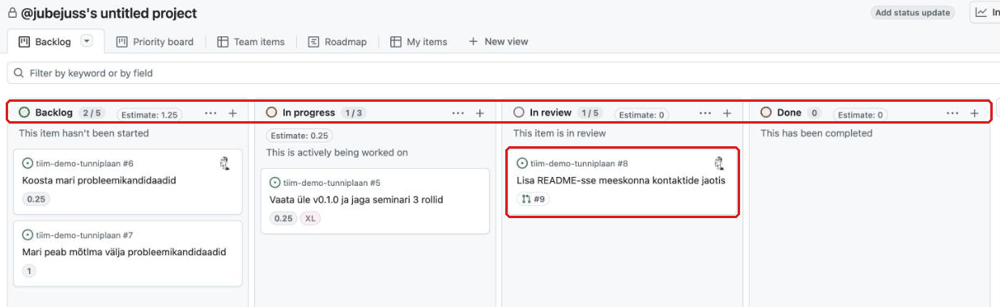
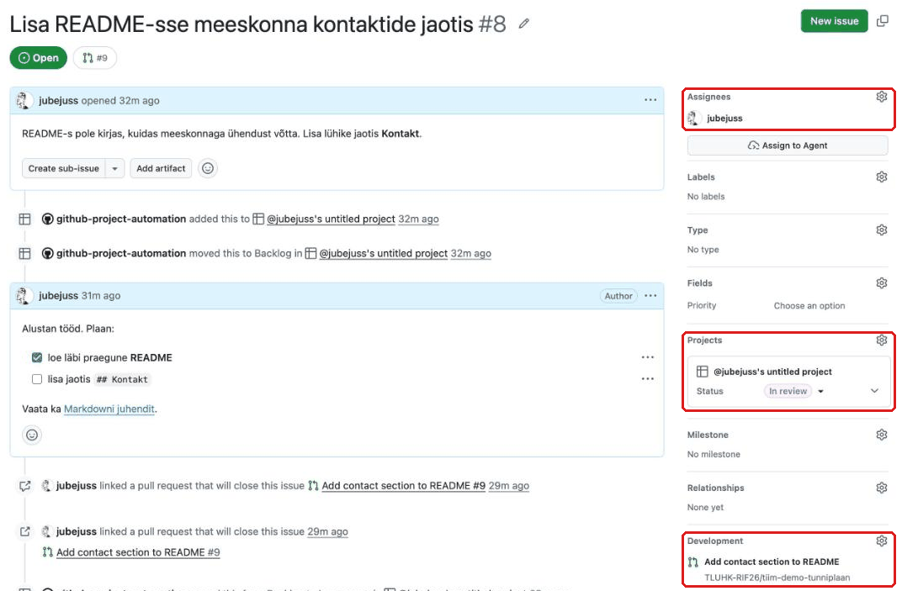

# Kanban ja ajahinnang

**Märge:** Seminaris

Kui meeskonnas on mitu inimest ja kümneid ülesandeid, peab kõigil olema näha, mis on tegemata, mis pooleli ja mis valmis. Selleks kasutatakse töötahvlit.

## Kanban

**Kanban** on töö korraldamise viis, kus iga ülesanne on kaart ja kaart liigub tahvlil veergude kaupa vasakult paremale:

```text
Backlog → In progress → Review → Done
```

| Veerg | Tähendus |
|---|---|
| **Backlog** | ootab tegemist |
| **In progress** | keegi teeb seda praegu |
| **Review** | töö on valmis ja ootab ülevaatust |
| **Done** | üle vaadatud ja ühendatud |

Kanbani põhireeglid:

- **Igal kaardil on vastutaja.** Kõik teavad, kelle poole pöörduda.
- **Igal kaardil on valmisoleku tingimus.** Kõik teavad, millal töö on tehtud.
- **Pooleliolevate tööde hulk on piiratud.** Parem lõpetada üks töö kui alustada kolme. Kui miski takerdub, aidake see enne uue alustamist lõpuni.

Kanban pärineb Toyota tehastest, kus kaardid näitasid tootmise seisu. Tarkvaraarenduses kasutatakse sama mõtet digitaalsel tahvlil.

## GitHub Projects

**GitHub Projects** on GitHubi töötahvel. Kaardid on repo Issue'd, nii et tahvel ja töö on omavahel seotud.



GitHubi valmismallis on ülevaatuse veeru nimi `In review`. Nimi pole oluline, peaasi et meeskond kasutab veerge ühtemoodi.

- Issue lisatakse tahvlile Issue lehe külgpaneelis valikuga **Projects**.
- Kaardi veergu saab muuta lohistades või Issue lehelt välja **Status** kaudu.
- Kui töö algab, vii kaart `In progress`. Kui avad PR-i, vii see ülevaatuse veergu (`Review` või `In review`). Pärast ühendamist `Done`.

Sarnased tööriistad on näiteks Jira, Trello ja ClickUp. Põhimõte on kõigis sama.

## Hea Issue

Issue on hea siis, kui iga meeskonnaliige saab sellest aru ilma küsimata:

```markdown
Eesmärk: kirjeldada vähemalt kolme võimalikku probleemi.
Fail: research/problem-candidates-mari.md
Valmis, kui: kandidaadid on kirjas ja kaaslane on PR-i üle vaadanud.
Ajahinnang: 2 tundi
Tähtaeg: 2027-10-01
```



Suure töö jaga väikesteks Issue'deks. Väike Issue on lihtsam hinnata, üle vaadata ja lõpetada.

## Prioriseerimine

Kõike ei jõua korraga. **Prioriseerimine** tähendab otsustamist, mida teha kõigepealt. Lihtne viis on **MoSCoW**:

- **Must have:** ilma selleta ei ole tulemust;
- **Should have:** oluline, aga saab hetkeks edasi lükata;
- **Could have:** tore, kui aega jääb;
- **Won't have (this time):** seekord teadlikult ei tee.

Järjesta Backlogi kaardid nii, et kõige olulisem on üleval.

## Ajahinnang

**Ajahinnang** on meeskonna parim pakkumine, kui kaua töö võtab. See aitab plaanida, kas töö mahub tähtajaks.

- Hinda väikseid töid. „2 tundi” on usaldusväärsem kui „2 nädalat”.
- Arvesta ka ülevaatuse ja paranduste ajaga.
- Pane hinnang Issue'sse kirja enne töö alustamist.

Etapi lõpus **võrdle hinnangut tegeliku ajakuluga**. Erinevus pole viga, vaid õppetund: järgmine plaan tuleb realistlikum. Algajad alahindavad aega peaaegu alati.

## Kontrolli ennast

1. Mis juhtub, kui meeskonnas on kõik kümme tööd korraga `In progress` veerus?
2. Kirjuta üks Issue, millel on eesmärk, valmisoleku tingimus ja ajahinnang.
3. Sinu hinnang oli 2 tundi, töö võttis 5. Mida järgmisel korral teisiti teed?

*Kuvatõmmised seisuga: november 2026.*

---

[← Dokumenteerimine](documentation.md) | [Sisukord](../README.md) | [Järgmine: Giti oskus: pull ja release →](git-pull-and-release.md)
