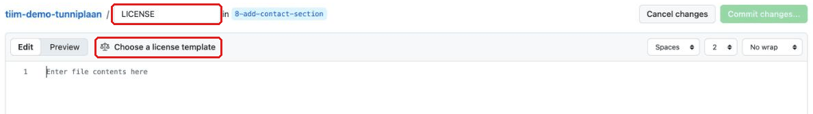

# Litsentsid

**Märge:** Seminaris

**Litsents** on autori luba kasutada tema koodi või muud materjali kindlatel tingimustel. Litsents ütleb, kas materjali tohib kasutada, muuta, edasi jagada ja äriliselt kasutada.

Litsents puudutab kõike, mida projekti lisad: koodi, teeke, pilte, fonte, andmeid ja tekste.

## Avalik ei tähenda vaba

Avalikku GitHubi repo't saab vaadata ja fork'ida. See ei tähenda, et selle koodi tohib oma projektis kasutada.

> [!IMPORTANT]
> Kui litsentsi pole, ei ole sul luba materjali kasutada. Autoriõigus kehtib ka ilma litsentsita.

## Levinud litsentsid

| Litsents | Mida lubab | Peamine tingimus |
|---|---|---|
| **MIT** | kasutada, muuta ja jagada, ka ärilises tarkvaras | säilita litsentsi tekst ja autori märkus |
| **Apache 2.0** | sama mis MIT, lisaks selge patendiluba | säilita nõutud märkused ja litsents |
| **GPL** | kasutada, muuta ja jagada | levitamisel tuleb ka tuletatud tarkvara jagada samadel tingimustel koos lähtekoodiga |
| **CC BY** | kasutada ja muuta teksti, pilti või muud sisu | viita autorile |

MIT ja Apache on **lubavad** litsentsid. GPL on **copyleft**-litsents: vabadus kandub edasi ka tuletatud tarkvarale. GPL ei keela ärilist kasutust.

**Creative Commonsi** (CC) litsentse kasutatakse tekstide ja piltide jaoks, mitte tarkvara jaoks. Tähised liidetakse kokku, näiteks CC BY-SA tähendab „viita autorile ja jaga samadel tingimustel”.

## Kontrolli enne kasutamist

Enne kui lisad projekti võõra materjali:

1. Leia algallikas, mitte koopia mõnel teisel lehel.
2. Leia litsents ja loe, mida see lubab.
3. Kontrolli, kas sinu kavandatud kasutus on lubatud.
4. Lisa materjali juurde autor, allikalink ja litsentsi nimi.

Allikale viitamine ei asenda kasutusluba. AI loodud materjali puhul kontrolli ka tööriista kasutustingimusi.

## Oma projekti litsents

Märgi oma projektile litsents ka siis, kui lubad seda tasuta kasutada. Nii teavad teised, mida nad tohivad teha. Litsents pannakse repo juurkausta faili `LICENSE`.

Litsentsi valimisel aitab leht [choosealicense.com](https://choosealicense.com/). GitHub pakub uue faili `LICENSE` loomisel valmis litsentsimalle: kirjuta failinimeks `LICENSE` ja vajuta **Choose a license template**.

Litsentsi valik on meeskonna otsus. Ära vali MIT-i ainult sellepärast, et see on tuntud.

## Kontrolli ennast

1. Leidsid GitHubist koodi ilma `LICENSE`-failita. Kas tohid seda oma projektis kasutada?
2. Mis vahe on lubaval ja copyleft-litsentsil?
3. Leia veebist üks pilt, mida tohib CC BY litsentsi alusel kasutada. Kirjuta, kuidas sellele viitad.

*Kuvatõmmised seisuga: november 2026.*

---

[← Rollid](roles.md) | [Sisukord](../README.md) | [Järgmine: Lähteülesanne →](project-brief.md)
