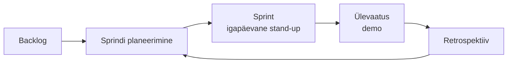

# Tööviisid

**Märge:** Seminaris

Osas 1 tutvusid Waterfalli ja iteratiivse arendusega. Nüüd vaatame, kuidas meeskond valib endale sobiva tööviisi ja miks.

## Tööviisid ei ole usutunnistused

| Tööviis | Põhimõte | Sobib, kui |
|---|---|---|
| **Waterfall** ehk kosemudel | etapid järgnevad üksteisele: nõuded, disain, teostus, testimine | nõuded on ette teada ja hiline muutus on kallis |
| **Iteratiivne** | lahendust täpsustatakse korduvates ringides | on palju ebaselgust ja iga ring annab uut infot |
| **Inkrementaalne** | tervik kasvab kasutatavate osade kaupa, alustades MVP-st | kasutajad saavad osa lahendusest varakult kasutusse võtta |
| **Agiilne** | sage koostöö, tagasiside ja plaani kohandamine väikeste sammudega | nõuded muutuvad ja kasutajatelt saab kiiresti tagasisidet |

Agiilne ei tähenda, et plaani või dokumentatsiooni pole. Plaan on olemas, aga seda muudetakse uue info põhjal.

Päris meeskonnad kombineerivad võtteid. Oluline pole meetodi nimi, vaid see, **miks** valitud töökorraldus aitab riske vähendada ja õppida.

## Scrum

*Seminaris nimetatakse Scrumi tööviisina. Sündmused ja vastutused on iseseisvaks lugemiseks.*

**Scrum** on levinuim agiilne raamistik. Töö käib lühikeste ajaliselt piiratud tsüklitena, mida nimetatakse **sprintideks** (tavaliselt 1–4 nädalat).

| Sündmus | Mis toimub |
|---|---|
| **Sprindi planeerimine** | meeskond valib backlog'ist tööd, mis mahuvad sprinti |
| **Stand-up** | igapäevane lühike kokkusaamine: mida tegin, mida teen, mis takistab |
| **Ülevaatus** (*sprint review*) | tulemust näidatakse tellijale ja kogutakse tagasisidet |
| **Retrospektiiv** | meeskond arutab, kuidas järgmisel korral paremini töötada |

Scrumis on kolm vastutust: **tooteomanik** järjestab tööd, **Scrum master** aitab meeskonnal protsessi järgida ja **arendajad** teevad töö.

**Valmisoleku määratlus** (*Definition of Done*) on meeskonna kokkulepe, millal töö on valmis, näiteks „üle vaadatud, ühendatud ja dokumenteeritud”.

## Kanban ja Lean

- **Kanban** keskendub töövoole: töö on tahvlil nähtav ja pooleliolevate tööde hulk on piiratud. Sprinte pole, töö liigub pidevalt. Vaata ka [Kanban ja ajahinnang](../02-from-request-to-task/06-kanban-and-estimates.md).
- **Lean** keskendub väärtusele ja raiskamise vähendamisele: ära tee seda, mis kasutajale väärtust ei loo.

## Kuidas tööviisi valida

Küsi meeskonnaga:

1. Kui hästi me nõudeid teame? Mida rohkem ebaselgust, seda rohkem kasu on lühikestest ringidest.
2. Kui kiiresti saame kasutajatelt tagasisidet?
3. Kui suur on meeskond ja kui palju aega on?
4. Milline on meie kõige riskantsem oletus ja kuidas seda kiiresti kontrollida?

Näiteks Suurbritannia riigiteenuste [alpha-etapis](https://www.gov.uk/service-manual/agile-delivery/how-the-alpha-phase-works) katsetatakse kõige riskantsemaid oletusi ja võrreldakse lahendusvariante, enne kui ühe juurde jäädakse.

Pane tööviisi valik otsuste logisse koos kaalutud alternatiividega.

## Rollid kui vaatenurgad

Rollide põhitabel on osas 2 lehel [Rollid](../02-from-request-to-task/02-roles.md). Otsuse juures esitab iga roll oma küsimuse:

| Roll | Küsimus |
|---|---|
| Tooteomanik | Millist väärtust ja kellele loome? |
| Projektijuht | Kuidas hoiame töö, aja ja sõltuvused juhitavana? |
| Analüütik | Millised vajadused peavad olema täidetud? |
| UX-disainer | Kuidas inimene lahendust kasutab? |
| Arhitekt | Millised osad ja piirid võimaldavad eesmärki täita? |
| Arendaja | Kuidas kavand teostatavaks muuta? |
| Testija | Kuidas teame, et tulemus on piisavalt hea? |
| Turbespetsialist | Milliseid ohte ja kohustusi peame arvestama? |

Roll ei anna ainuõigust otsustada. See paneb meeskonna vaatama sama otsust eri külgedest. Kursusel vahetuvad rollid etappide vahel, et igaüks kogeks erinevat vaatenurka.

## Kuidas AI tööjaotust muudab

Elutsükli etapid jäävad samaks, kuid muutub see, kes mida teeb. Anthropicu 2026. aasta artikkel [The AI-native SDLC playbook](https://claude.com/resources/articles/the-ai-native-sdlc-playbook) kirjeldab, et kui AI-agendid kirjutavad koodi kiiresti, liigub kitsaskoht mujale: planeerimisse, ülevaatusse, testimisse ja kasutuselevõttu. Inimese töö nihkub kirjutamiselt suunamisele ja kontrollimisele.

Hoia meeles kolm asja:

- Artikli on avaldanud ettevõte, kes selliseid tööriistu müüb. Kiiruse kohta käivad väited on ootused, mitte mõõdetud tulemused.
- Enamik organisatsioone töötab vana ja uue vahepeal.
- AI väljund ei ole tõend ja otsuse eest vastutab inimene.

Iga teema juures küsi: millist tööd võiks teha AI, kuidas tulemust kontrollime ja kes vastutab?

## Kontrolli ennast

1. Miks ei ole „me teeme agiilselt” tööviisi valiku põhjendus?
2. Mis vahe on Scrumil ja Kanbanil?
3. Kirjelda üht projekti, kuhu sobiks Waterfall paremini kui agiilne arendus.
4. Mida tähendab valmisoleku määratlus ja miks see meeskonnale kasulik on?

---

[← Osa ülevaade](README.md) | [Sisukord](../README.md) | [Järgmine: Kasutajalood ja nõuded →](02-user-stories-and-requirements.md)
