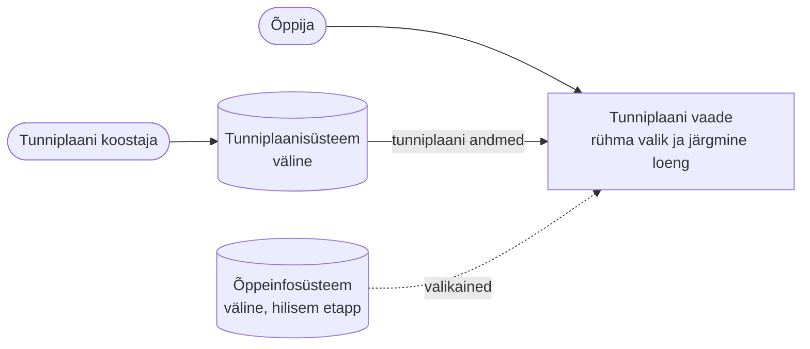

[← Backlog](03-backlog.md) | [Sisukord](../README.md) | [Järgmine: Arhitektuuri põhimõisted →](05-architecture-basics.md)

# Süsteemi kontseptsioon

**Märge:** Seminaris

**Süsteemi kontseptsioon** on lühike kirjeldus sellest, mis süsteem see on, kellele see on mõeldud ja kuidas see põhimõtteliselt töötab. See ütleb, **mida** süsteem teeb, aga mitte seda, millega see ehitatakse.

**Kõrgtaseme arhitektuur** kirjeldab süsteemi suuremaid osi, nende vastutust ja omavahelisi seoseid. Kursusel teeme sellest lihtsa visandi, mitte detailset tehnilist arhitektuuri ega tehnoloogiate valikut.

## Mida kontseptsioon sisaldab

| Osa | Küsimus |
|---|---|
| **Eesmärk** | Milleks süsteem on? |
| **Osalised** | Kes süsteemi kasutavad või sellega suhtlevad? |
| **Piir** | Mis on süsteemi sees ja mis jääb välja? |
| **Teekond** | Kuidas kasutaja oma eesmärgini jõuab? |
| **Osad** | Millistest suurematest osadest süsteem koosneb ja millise loo jaoks iga osa vajalik on? |
| **Info liikumine** | Kust info tuleb ja kuhu see liigub? |
| **Välised sõltuvused** | Milliseid teisi süsteeme või teenuseid on vaja? |
| **Teadmatused** | Mida me veel ei tea? |

Kontseptsiooni osad tulenevad kasutajalugudest ja sõltuvustest. Kui kontseptsiooni kirjutades selgub uus sõltuvus, võib sellest tekkida uus lugu või lahtine küsimus.

## Näide (väljamõeldud)

> **Eesmärk:** õppija leiab telefonis ja arvutis kiiresti oma rühma järgmise loengu aja ja ruumi ning on kindel, et see on tema rühma info.
>
> **Osalised:** õppija vaatab tunniplaani; tunniplaani koostaja sisestab selle olemasolevasse tunniplaanisüsteemi.
>
> **Piir:** süsteem näitab tunniplaani ja aitab õppijal oma rühmani jõuda. Süsteem ei koosta tunniplaani ega muuda õppekava.
>
> **Osad:** rühma valik ja valitud rühma näitamine; järgmise loengu vaade; tunniplaani andmete lugemine.
>
> **Välised sõltuvused:** tunniplaanisüsteem. Valikainete näitamiseks oleks vaja ka õppeinfosüsteemi andmeid.
>
> **Teadmatused:** kui palju aega kulub praegu järgmise loengu leidmiseks? Kas õppeinfosüsteemi andmeid saab kasutada?

Sama kontseptsioon skeemina:

Katkendjoon näitab sõltuvust, mis on veel lahtine. Skeem on kasulik ainult siis, kui see selgitab mõtet. Ilusad, kuid põhjendamata kastid ei ole eesmärk.

## Lahendussuunad

Kontseptsioon võib viia mitme lahendussuunani. Kirjelda vähemalt kaks ja võrdle neid:

- **A) Parandada olemasolevat tunniplaanilehte.** Lahendab tõendatud probleemi ja sõltub ainult tunniplaanisüsteemist.
- **B) Luua isiklik tunniplaan, mis ühendab mitme süsteemi andmed.** Lahendab ka valikainete probleemi, aga sõltub teisest süsteemist, mille andmete kasutamine pole kindel.

Näidismeeskond valib A, sest see lahendab tõendatud probleemi väiksema riskiga. B jääb lahtiseks küsimuseks. Valik läheb otsuste logisse.

Suunad peavad päriselt erinema. Kui B on „A pluss midagi”, ei ole see eraldi suund, vaid A laiendus, ja valik kaldub alati suurema poole. Võrdle suundi, mis lahendavad probleemi eri viisil.

Igal valikul on hind. Kirjuta **kompromiss** välja: millest loobume ja mida selle eest saame. „Valime A, sest see on parem” ei ole põhjendus. „Valime A ja loobume valikainetest, sest õppeinfosüsteemi andmete kasutamine on teadmata” on põhjendus.

## Kontrolli kontseptsiooni

1. Kas igal teekonna sammul, kus probleem esineb, on vähemalt üks lugu?
2. Kas iga lugu on seotud teekonna sammuga?
3. Kas iga kontseptsiooni osa on vajalik mõne loo või sõltuvuse jaoks? Kui ei ole, on see üleliigne.

## Kontrolli ennast

1. Mis vahe on süsteemi kontseptsioonil ja tehnoloogia valikul?
2. Miks on oluline kirja panna, mis jääb süsteemi piirist välja?
3. Joonista oma igapäevase rakenduse kohta lihtne skeem: osalised, osad ja vähemalt üks väline sõltuvus.

---

[← Backlog](03-backlog.md) | [Sisukord](../README.md) | [Järgmine: Arhitektuuri põhimõisted →](05-architecture-basics.md)
