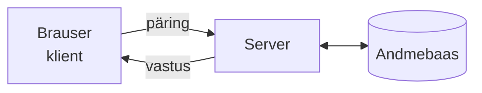

# Arhitektuuri põhimõisted

**Märge:** Iseseisev

Süsteemi kontseptsiooni kirjutades ja arendajatega rääkides kohtad mõisteid, mis kirjeldavad, kuidas tarkvara osad omavahel suhtlevad. Sellel lehel on nende mõistete lühike selgitus. Täpsemalt õpid neid järgmistes erialaainetes.

## Klient ja server

Enamik tänapäeva rakendusi koosneb kahest poolest:

- **Klient** (*client*) on programm kasutaja seadmes: veebibrauser või telefonirakendus. See näitab infot ja võtab vastu kasutaja tegevusi.
- **Server** on arvuti või teenus, mis hoiab andmeid ja töötleb päringuid. Sellega suhtlevad korraga paljud kliendid.

Klient saadab serverile **päringu** (*request*), näiteks „näita rühma A tunniplaani”, ja server saadab tagasi **vastuse** (*response*).

## Frontend ja backend

- **Frontend** on rakenduse osa, mida kasutaja näeb ja millega suhtleb: lehe kujundus, nupud ja vormid. Veebis kasutatakse selleks HTML-i, CSS-i ja JavaScripti.
- **Backend** on rakenduse osa serveris: äriloogika, andmete töötlemine ja salvestamine. Seda kasutaja otse ei näe.

Frontend ja backend on sageli eri inimeste või meeskondade töö.

## API

**API** (*Application Programming Interface*, rakendusliides) on kokkulepitud viis, kuidas üks programm küsib teiselt andmeid või teenust. API kirjeldab, milliseid päringuid saab teha ja millise vastuse saab.

Näiteks tunniplaani rakendus võib õppeinfosüsteemi API kaudu küsida õppija valikaineid. Kui API-t pole, ei saa andmeid automaatselt kätte. Seepärast on väliste süsteemide API-d sageli kontseptsiooni olulised sõltuvused ja riskid.

## Andmebaas

**Andmebaas** (*database*) hoiab andmeid korrastatult, et neid saaks kiiresti otsida, muuta ja säilitada. Näiteks tunniplaani loengud, rühmad ja ruumid on andmebaasis. Tavaliselt suhtleb andmebaasiga backend, mitte kasutaja otse.

## Pilv

**Pilv** (*cloud*) tähendab, et server, andmebaas ja muu taristu ei asu ettevõtte enda ruumides, vaid neid renditakse teenusepakkujalt, näiteks Amazon Web Services, Microsoft Azure või Google Cloud. Ressursse saab vastavalt vajadusele juurde võtta või vähendada.

Ka GitHub, kus hoiame oma repo't, on pilveteenus.

## Kuidas see seostub kontseptsiooniga

Süsteemi kontseptsioonis ei pea neid mõisteid kasutama. Kontseptsioon kirjeldab osi nende vastutuse järgi, näiteks „tunniplaani vaade” ja „tunniplaani andmete lugemine”. Arendusmeeskond otsustab hiljem, kas osa on frontendis, backendis või välises süsteemis.

## Kontrolli ennast

1. Mis vahe on kliendil ja serveril?
2. Too näide, kus üks rakendus kasutab teise rakenduse API-t.
3. Miks on väline API süsteemi kontseptsioonis risk?

---

[← Süsteemi kontseptsioon](04-system-concept.md) | [Sisukord](../README.md) | [Järgmine: Giti oskus: merge-konflikt →](06-git-merge-conflict.md)
