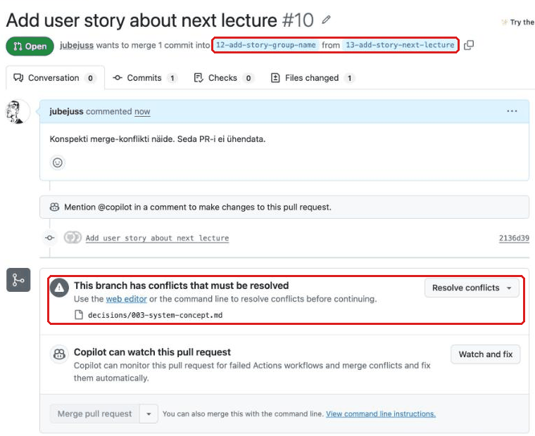
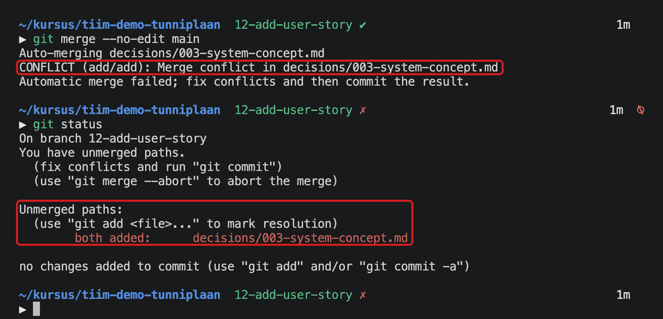
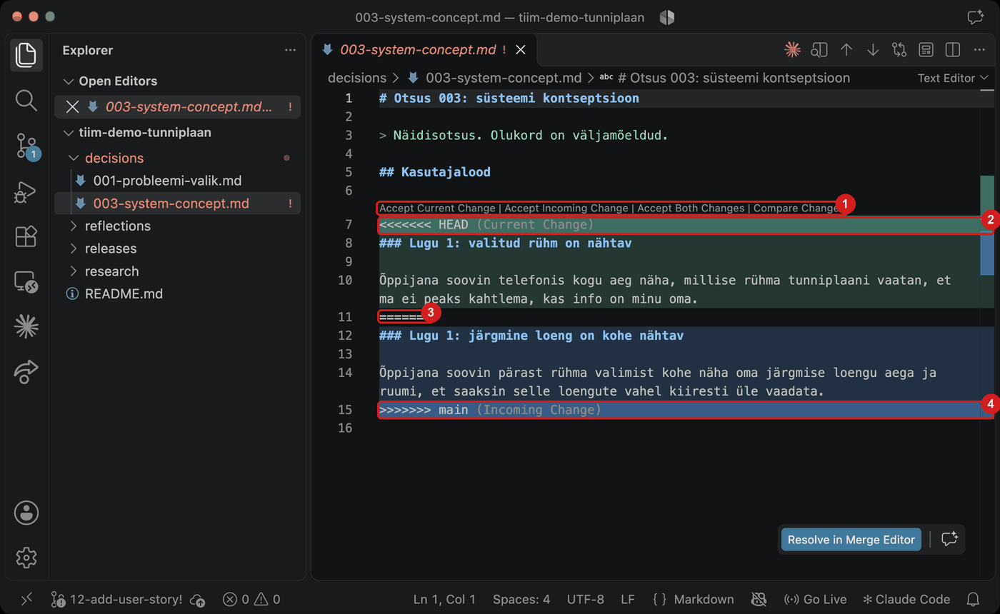

# Giti oskus: merge-konflikt

**Märge:** Seminaris

**Merge-konflikt** tekib, kui kaks haru muudavad sama rida samas failis. Git ei tea, kumb muudatus jätta, ja peatab ühendamise, kuni inimene otsustab.

Konflikt ei ole viga ega märk halvast tööst. See on tavaline olukord, kui mitu inimest töötavad sama faili kallal. Kui muudatused on samas failis, aga eri kohtades, ühendab Git need ise.

## Kuidas konfliktist teada saad

- GitHubi pull request'is on teade **This branch has conflicts that must be resolved**.
- Terminalis näitab `git merge` rida `CONFLICT` ja faili nime.



## Konfliktimärgid

Konfliktis failis näeb vastuoluline koht välja nii:

```text
<<<<<<< HEAD
Õppijana soovin näha oma rühma nime kogu aeg.
=======
Õppijana soovin näha järgmist loengut kohe pärast rühma valimist.
>>>>>>> main
```

| Märk | Tähendus |
|---|---|
| `<<<<<<< HEAD` | algab sinu haru tekst |
| `=======` | eraldaja |
| `>>>>>>> main` | lõpeb `main`-i tekst |

Otsusta, mis jääb: üks variant, mõlemad või uus tekst. Seejärel kustuta kõik kolm märgirida.

## Lahendamine terminalis

Näites on sinu haru `12-add-user-story`. Asenda see oma haru nimega.

```bash
git status                       # 1. kontrolli, et commit'imata muudatusi pole
git switch main                  # 2. too main-i uus seis
git pull --ff-only
git switch 12-add-user-story     # 3. mine tagasi oma harusse
git merge --no-edit main         # 4. ühenda main oma harusse
```

`--no-edit` tähendab, et Git ei ava ühendamise sõnumi jaoks tekstiredaktorit. Kui konflikti ei teki, on `main` nüüd sinu harus ja jätka käsuga `git push`.

Kui Git teatab `CONFLICT`:

```bash
git status                       # 5. konfliktis failid on all "Unmerged paths"
```

6. Ava fail, otsusta, mis jääb, ja kustuta märgiread.
7. Märgi konflikt lahendatuks ja tee commit:

```bash
git add decisions/003-system-concept.md
git commit -m "Resolve conflict in user stories"
git push
```

Pull request uueneb ise ja konfliktiteade kaob. Muudatuse vaatab üle kaaslane nagu tavaliselt.



## Lahendamine VS Code'is

Sammud 1–4 on samad. Seejärel:

1. Ava **Source Control**. Konfliktis failid on jaotises **Merge Changes**.
2. Ava fail. Konfliktse koha kohal on valikud:
   - **Accept Current Change** jätab sinu haru teksti;
   - **Accept Incoming Change** jätab `main`-i teksti;
   - **Accept Both Changes** jätab mõlemad.
3. Paranda vajaduse korral tekst käsitsi ja salvesta.
4. Vajuta faili juures `+`, kirjuta sõnum ja vajuta **Commit**, seejärel **Sync Changes**.



Pildil on 1 valikud, 2 sinu haru teksti algus (`HEAD`, roheline), 3 eraldaja ja 4 `main`-i teksti lõpp (sinine). Nupp **Resolve in Merge Editor** avab konflikti suuremas kolme paneeliga vaates.

## Kui läks segaseks

Kui commit'i pole veel tehtud, saad ühendamise katkestada:

```bash
git merge --abort
```

Failid lähevad tagasi seisu, mis oli enne ühendamist.

> [!CAUTION]
> Ära kasuta käsku `git push --force`. See võib kustutada teiste töö.

## Kuidas konflikte vähendada

- Hoia harud lühikesed: väike töö, kiire PR.
- Uuenda oma haru `main`-iga enne PR-i avamist.
- Lepi meeskonnaga kokku, kes millist faili või osa muudab.

Kui lahendad konflikti, mis puudutab kaaslase teksti, räägi temaga. Kirjuta PR-i kommentaari, mis jäi alles ja miks.

## Kontrolli ennast

1. Miks tekib konflikt ainult siis, kui muudetakse sama kohta?
2. Mida tähendavad märgid `<<<<<<<`, `=======` ja `>>>>>>>`?
3. Mida teed, kui konflikti lahendamine läks segaseks ja commit'i pole veel tehtud?

*Kuvatõmmised seisuga: november 2026.*

---

[← Arhitektuuri põhimõisted](05-architecture-basics.md) | [Sisukord](../README.md) | [Järgmine osa: Kvaliteet, riskid ja vastutus →](../04-quality-and-risk/README.md)
