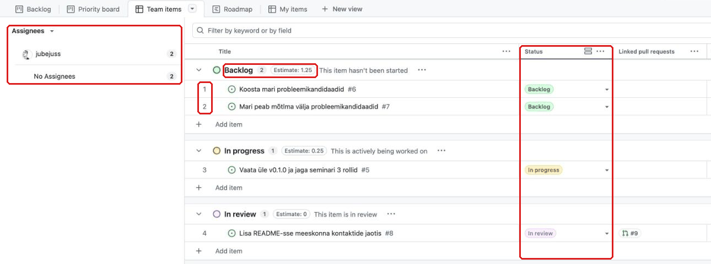

# Backlog

**Märge:** Seminaris

**Backlog** on järjestatud nimekiri töödest, mida meeskond peab tegema. GitHub Projectsi tahvlil on see veerg `Backlog`. Hea backlog aitab otsustada, mida teha järgmisena ja mis võib oodata.

## Kasutajaloost Issue'ks

Iga kasutajalugu või muu töö saab backlog'is oma Issue. Issue'l on:

- selge eesmärk ja link loole või otsusele;
- vastutaja;
- ajahinnang;
- valmisoleku tingimus, mis loo puhul on selle kontrolltingimus.

Kui Issue on liiga suur, et seda paari päevaga teha, jaga see väiksemateks.

Backlog kirjeldab **toote** tööd, mitte õppeülesande samme. „HW3-02 kirjuta kontseptsioon” on kodutöö samm. „Kontrolli, milliseid välju tunniplaani andmeallikas sisaldab” on toote töö: see tuleneb loost või riskist ja jääb tähtsaks ka pärast kodutööd.

## Järjestamine

Backlog'i ülemine töö tehakse esimesena. Järjesta kolme küsimusega:

| Küsimus | Mida see tähendab |
|---|---|
| **Väärtus** | Kui palju aitab see töö kasutajat? |
| **Risk** | Kas see kontrollib meie kõige ebakindlamat oletust? Riskantne töö tasub teha varakult, et halb uudis tuleks enne, kui palju aega on kulunud. |
| **Sõltuvused** | Kas see töö peab olema tehtud enne mõnda teist? |

Näiteks lugu, mis sõltub teise asutuse süsteemist, mille andmeid me ei pruugi saada, ei sobi esimeseks tööks. See jääb backlog'i allossa ja selle risk pannakse kontseptsiooni kirja.

Tabelivaates on järjekord ja hinnangud paremini näha kui tahvlil.

## Backlog muutub

Backlog ei ole lõplik plaan. Uue info põhjal lisandub töid, mõni kaob ja järjekord muutub. Seepärast vaadatakse backlog regulaarselt üle, näiteks iga etapi alguses. Seda nimetatakse ka **backlog'i täpsustamiseks** (*backlog refinement*).

Lahtised küsimused ja ideed, mille kohta tõendeid pole, ei kuulu backlog'i. Hoia need eraldi nimekirjas, kuni neid on kontrollitud.

## Õpi eelmisest hinnangust

Enne uute tööde hindamist vaata eelmise etapi võrdlust: hinnang ja tegelik ajakulu. Mida jätsid arvestamata? Tavalised põhjused on ülevaatuse ootamine, parandused ja kooskõlastamine.

Kasuta seda õppetundi uutes hinnangutes ja pane kirja üks konkreetne parandus.

## Kontrolli ennast

1. Miks tasub riskantne töö teha varakult?
2. Mis vahe on backlog'il ja lahtiste küsimuste nimekirjal?
3. Sinu meeskonna Issue'l on hinnang „1 nädal”. Mida sellega teed?

*Kuvatõmmised seisuga: november 2026.*

---

[← Kasutajalood ja nõuded](user-stories-and-requirements.md) | [Sisukord](../README.md) | [Järgmine: Süsteemi kontseptsioon →](system-concept.md)
