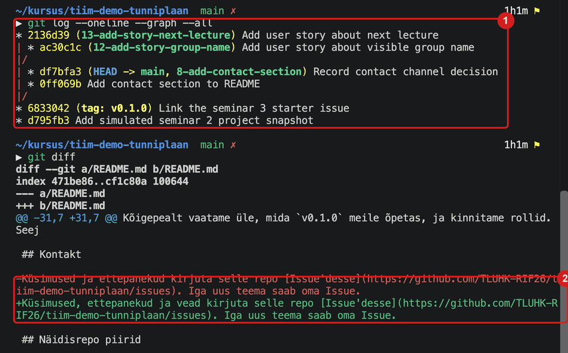
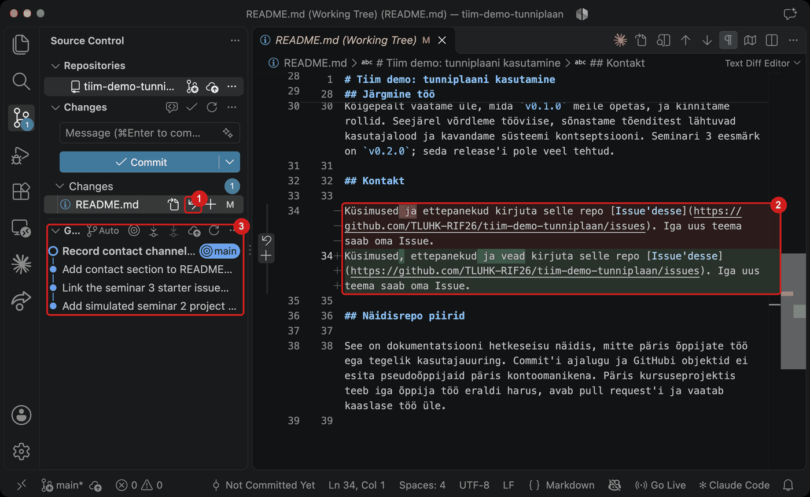

[← Koodi kvaliteet](05-code-quality.md) | [Sisukord](../README.md) | [Järgmine osa: Kasutuselevõtt, käitus ja areng →](../05-deployment-and-evolution/README.md)

# Giti oskus: ajalugu ja tagasivõtmine

**Märge:** Seminaris

Giti ajalugu näitab, kes mida ja millal muutis. See aitab mõista, kuidas projekt arenes, ja leida, millal mingi muudatus tehti. Selle lehe kolm käsku vastavad kolmele küsimusele:

| Küsimus | Käsk |
|---|---|
| Mis on tehtud? | `git log` |
| Mida ma praegu muutsin? | `git diff` |
| Kuidas oma muudatusest loobuda? | `git restore` |

## git log

`git log` näitab commit'ide ajalugu, uuemad eespool.

```bash
git log --oneline            # iga commit ühel real
git log --oneline -5         # ainult viimased 5
git log --oneline --graph    # harud ja ühendamised joontena
```

Iga rea alguses on commit'i **lühitunnus** (*hash*), näiteks `a1b2c3d`, ja selle järel sõnum. Kui väljund ei mahu ekraanile, keri nooltega ja välju klahviga `q`.

Siit on hästi näha, miks head commit'i sõnumid on olulised. Sõnumitest `update`, `fix`, `asdf` ei saa aru, mida tehti. Sõnumitest `Add risk map`, `Clarify acceptance criterion` saab.

## git diff

`git diff` näitab muudatusi, mida pole veel commit'itud.

```bash
git diff                     # muudetud, aga git add'ita failid
git diff README.md           # ainult ühe faili muudatused
git diff --cached            # git add'itud, aga commit'imata muudatused
```

Väljundis on `-` algusega read eemaldatud ja `+` algusega read lisatud.



## git restore

`git restore` võtab commit'imata muudatuse tagasi: fail läheb tagasi viimase commit'i seisu.

```bash
git restore README.md            # loobu README.md muudatustest
git restore --staged README.md   # võta fail git add'ist tagasi, muudatus jääb alles
```

> [!WARNING]
> `git restore <fail>` kustutab commit'imata muudatused jäädavalt. Neid ei saa tagasi. Vaata enne alati `git diff` väljund üle.

`git restore --staged` on ohutu: see ainult eemaldab faili järgmisest commit'ist, muudatus failis jääb alles.

### Kui commit on juba tehtud

`git restore` töötab ainult commit'imata muudatustega. Kui vale muudatus on juba commit'itud ja push'itud, ära muuda ajalugu. Tee uus commit, mis muudatuse parandab. Selleks on olemas ka käsk `git revert <hash>`, mis loob automaatselt vastupidise commit'i.

## VS Code'is



1. **Discard Changes** (nool tagasi) ilmub, kui viid hiire faili peale. See on sama mis `git restore`.
2. Faili klõpsates avaneb muudatuse võrdlus: sama mis `git diff`.
3. **Graph** näitab commit'ide ajalugu: sama mis `git log --graph`.

## Harjutus

1. Käivita oma meeskonna repos `git log --oneline -10`. Kas sõnumitest saab aru, mida tehti?
2. Muuda mõnda faili proovimiseks.
3. Vaata muudatust käsuga `git diff`.
4. Võta muudatus tagasi käsuga `git restore <fail>`.
5. Kontrolli käsuga `git status`, et töökaust on puhas.

## Kontrolli ennast

1. Mida näitab `git log --oneline`?
2. Mis vahe on `git diff` ja `git diff --cached` väljundil?
3. Miks tuleb enne `git restore` käsku vaadata `git diff` väljundit?
4. Mida teha, kui vale muudatus on juba push'itud?

*Kuvatõmmised seisuga: november 2026.*

---

[← Koodi kvaliteet](05-code-quality.md) | [Sisukord](../README.md) | [Järgmine osa: Kasutuselevõtt, käitus ja areng →](../05-deployment-and-evolution/README.md)
