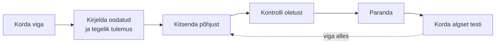

# Vea silumine ja koodi ülevaatus

**Märge:** Iseseisev

Arendamise etapis muudavad arendajad nõuded ja kavandi töötavaks tarkvaraks: kirjutavad koodi, parandavad vigu ja vaatavad üksteise koodi üle. Sellel kursusel rakendust ei ehitata, kuid kaks arendaja oskust on kasulikud igas rollis: vea kirjeldamine ja ülevaatus.

## Viga

**Viga** (*bug*) on olukord, kus süsteem käitub teisiti, kui oodati. Viga ei ole alati koodis: põhjus võib olla ka valesti mõistetud nõudes või andmetes.

## Silumine

**Silumine** (*debugging*) on vea põhjuse otsimine ja parandamine. See käib ringina:



1. **Korda viga** võimalikult väikese näitega. Viga, mida ei saa korrata, on raske parandada.
2. **Kirjelda** oodatud ja tegelik tulemus.
3. **Kitsenda** põhjust: mis osa võib vea tekitada?
4. **Kontrolli** oma oletust, mitte ära paranda pimesi.
5. **Paranda** ja **korda** algset testi. Hea tava on lisada test, mis tagab, et sama viga tagasi ei tule.

### Vea kirjeldus

Hea vea kirjeldus aitab teisel viga korrata ilma sinult küsimata:

```markdown
Sisend: [2, 4, 6]
Oodatud tulemus: 4
Tegelik tulemus: 6
Kuidas korrata: käivita average([2, 4, 6])
Oletatav põhjus: jagatakse arvuga, mis on ühe võrra väiksem kui elementide arv
```

## Harjutus

Funktsioon peaks arvutama arvude keskmise:

```python
def average(values):
    return sum(values) / (len(values) - 1)
```

1. Ennusta ilma koodi käivitamata, mis tuleb sisendiga `[2, 4, 6]`.
2. Kirjuta vea kirjeldus ülaltoodud kujul.
3. Paranduses on rida `return sum(values) / len(values)`. Vaata see üle nagu pull request'i ja kirjuta üks sisuline küsimus. Vihje: mis juhtub tühja loendiga?
4. Valikuline: käivita kood terminalis käsuga `python3`.

Koodi kirjutama ei pea. Eesmärk on näha, kuidas viga kirjeldatakse ja kuidas ülevaatus küsib erijuhtude kohta.

## Koodi ülevaatus

**Koodi ülevaatuses** (*code review*) loeb kaaslane muudatuse enne ühendamist läbi. Ülevaatus leiab vigu, mida autor ei näe, ja levitab teadmist: vähemalt kaks inimest teavad, mis muutus.

Ülevaataja kontrollib:

- Kas muudatus teeb seda, mida pull request lubab?
- Kas sellest saab aru ka keegi teine?
- Mis juhtub erijuhtudel: tühi sisend, puuduvad andmed, väga suur arv?

### Hea kommentaar

| Halb | Hea |
|---|---|
| „Korras.” | „Mis juhtub, kui loend on tühi? Praegu jagatakse nulliga.” |
| „See on vale.” | „Rida 3 jagab arvuga `len - 1`. Kas see on meelega?” |
| „Sa ei oska koodi kirjutada.” | „Muutuja `x` nimest ei saa aru, mida see hoiab. Kas `count` sobiks?” |

Hea kommentaar on konkreetne, ütleb, kus probleem on, ja kommenteerib koodi, mitte inimest. Küsimus on sageli parem kui käsk: võib-olla oli autoril põhjus, mida ülevaataja ei näe.

Sama kehtib dokumentide kohta. Kasutajaloo või otsuse ülevaatus on samuti koodi ülevaatus, lihtsalt tekstiga.

> [!NOTE]
> Kui koodi kirjutas AI, vaatab selle üle inimene. Koodi kirjutanud agent ei saa enda tööd ise heaks kiita.

## Kontrolli ennast

1. Miks tuleb viga enne parandamist korrata?
2. Kirjuta vea kirjeldus mõne vea kohta, mida oled mõnes rakenduses kohanud.
3. Mis teeb ülevaatuse kommentaarist hea kommentaari?

---

[← Testjuhtum](test-cases.md) | [Sisukord](../README.md) | [Järgmine: Riskid →](risks.md)
