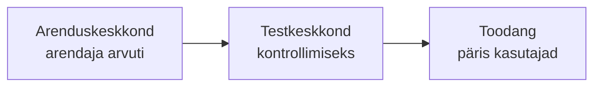

[← Osa ülevaade](README.md) | [Sisukord](../README.md) | [Järgmine: Tagasiside ja areng →](02-feedback-and-evolution.md)

# Kasutuselevõtt ja käitus

**Märge:** Seminaris

> [!NOTE]
> See leht on mustand. Seminari 5 sisu võib pärast selle esimest läbiviimist muutuda.

## Release ei ole finiš

**Kasutuselevõtt** (*deployment*) teeb süsteemi päris kasutajatele kättesaadavaks. Alles siis ilmnevad uued vajadused, ootamatud kasutusviisid, vead ja kõrvalmõjud. Keegi peab süsteemi jälgima, toetama, parandama ja uuendama. Seda nimetatakse **käituseks** (*operations*).

## Keskkonnad

Tarkvara ei liigu arendaja arvutist otse kasutajani. Vahepeal on tavaliselt mitu **keskkonda**:

| Keskkond | Kes kasutab | Milleks |
|---|---|---|
| **Arenduskeskkond** (*development*) | arendaja | kirjutab ja proovib muudatusi |
| **Testkeskkond** (*test, staging*) | testija, tellija | kontrollib muudatust päris andmetele sarnaste andmetega |
| **Toodang** (*production*) | päris kasutajad | igapäevane kasutus |

Viga testkeskkonnas on odav. Sama viga toodangus mõjutab päris inimesi.

### CI/CD

*See lõik on iseseisvaks lugemiseks.*

**CI** (*continuous integration*, pidev integreerimine) tähendab, et iga muudatuse järel käivitatakse automaatselt testid ja kontrollid. Kui midagi läks katki, saab meeskond sellest kohe teada.

**CD** (*continuous delivery / deployment*, pidev tarnimine) tähendab, et kontrolli läbinud muudatus jõuab automaatselt test- või toodangukeskkonda.

GitHubis tehakse seda **GitHub Actionsi** abil: repo sees olev fail kirjeldab, mis iga push'i järel automaatselt käivitub.

## Kasutuselevõtu otsused

Enne kasutuselevõttu pane kirja:

- **Kes ja millal** alustab kasutamist?
- **Kuidas kasutajad muudatusest teada saavad** ja millist juhendamist nad vajavad?
- **Korraga või sammhaaval?** Sammhaaval tähendab, et esialgu kasutab uut versiooni väike osa kasutajatest. Kui midagi läheb valesti, on mõju väike.
- **Kuidas märkame probleeme?**
- **Millal peatame või pöörame tagasi?** **Tagasipööramine** (*rollback*) tähendab eelmise töötava versiooni taastamist.
- **Kes otsustab** järgmise versiooni sisu?

## Seire

**Seire** (*monitoring*) tähendab süsteemi pidevat jälgimist, et probleemid märgataks enne, kui kasutajad neist teatavad. Jälgitakse näiteks:

- kas süsteem töötab ja kui kiiresti see vastab;
- kui palju vigu tekib;
- kas kasutajad saavad oma eesmärgi täidetud;
- toe pöördumisi;
- turbe- ja privaatsusjuhtumeid.

Seire on seotud osa 4 riskikaardiga: veerg „kuidas märkame” ütleb, mida jälgida.

## Hooldus

**Hooldus** (*maintenance*) on süsteemi töökorras hoidmine pärast kasutuselevõttu. Sageli kulub hooldusele rohkem aega kui esialgsele arendusele.

*Hoolduse liigid on iseseisvaks lugemiseks.*

| Liik | Mida tehakse | Näide |
|---|---|---|
| **Parandav** | vigade parandamine | tühja nädala viga parandatakse |
| **Kohandav** | kohanemine muutunud keskkonnaga | andmeallika vorming muutus |
| **Täiendav** | uute võimaluste lisamine | lisatakse valikainete vaade |
| **Ennetav** | tulevaste probleemide vältimine | tehnilise võla tagasimaksmine, vananenud teekide uuendamine |

Hooldusel peab olema **omanik**: inimene või meeskond, kes vastutab süsteemi eest ka pärast projekti lõppu.

## Süsteemi lõpetamine

Ka süsteemi sulgemine on arendusotsus. Läbi tuleb mõelda:

- mis saab andmetest: säilitatakse, antakse üle või kustutatakse;
- kuidas kasutajaid teavitatakse ja kui palju aega neil on;
- mis on asendusteenus;
- millised lepingud ja sõltuvused tuleb lõpetada.

## Kontrolli ennast

1. Miks ei liigu muudatus arendaja arvutist otse toodangusse?
2. Mis eelis on sammhaaval kasutuselevõtul?
3. Mis vahe on parandaval ja täiendaval hooldusel?
4. Mida tuleb läbi mõelda, kui süsteem suletakse?

---

[← Osa ülevaade](README.md) | [Sisukord](../README.md) | [Järgmine: Tagasiside ja areng →](02-feedback-and-evolution.md)
